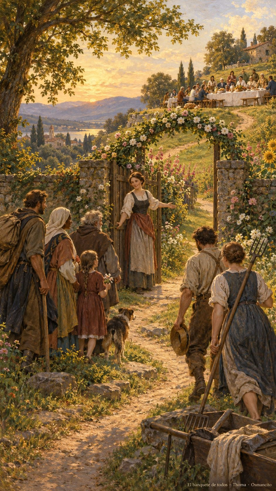
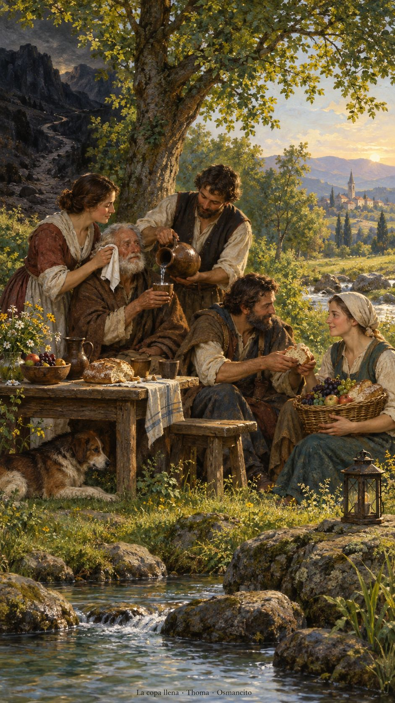

11 de octubre de 2026

_¡Buenos días!_

# El banquete de todos

**1**

> El Señor del universo preparará sobre este monte un festín con platillos suculentos para todos los pueblos; un banquete con vinos exquisitos y manjares sustanciosos.

Isaías 25,6. [Fuente](https://bible.usccb.org/es/bible/lecturas/101126.cfm)

_Que aceptemos la invitación de sentarnos juntos, sin preguntar primero quién merece la silla. Que preparemos una mesa donde el cansancio encuentre descanso y las lágrimas una mano cercana. Que aprendamos a compartir cuando sobra y cuando falta, agradeciendo la ayuda que llega. Que ningún camino oscuro nos haga olvidar las aguas tranquilas. Que vistamos de cuidado nuestra presencia y entremos de verdad en la alegría: haciendo sitio, ofreciendo pan y acompañándonos hasta volver juntos._

- La puerta abierta en el cruce de caminos recoge la invitación de Mateo 22. La mesa sobre la colina y los frutos recuerdan el festín para todos los pueblos de Isaías 25.

- El paño junto al rostro recuerda las lágrimas enjugadas de Isaías. El arroyo, la pradera y la copa reciben el Salmo 22; el pan compartido entre escasez y abundancia recoge Filipenses 4.

**_¡Feliz domingo 11 de octubre!_**

😊🙋‍♂
