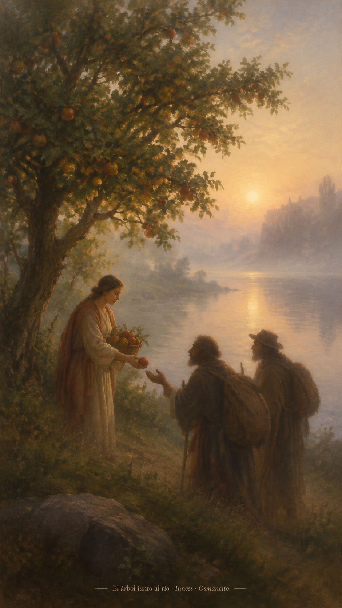
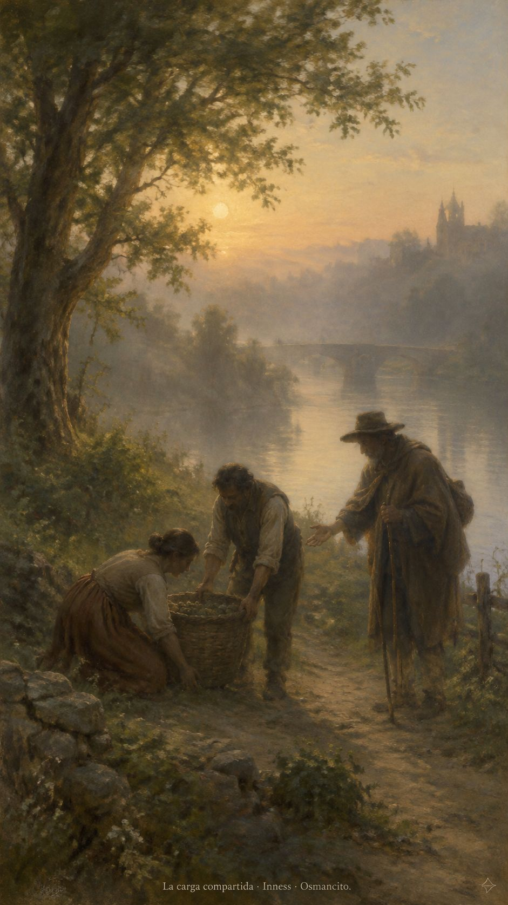
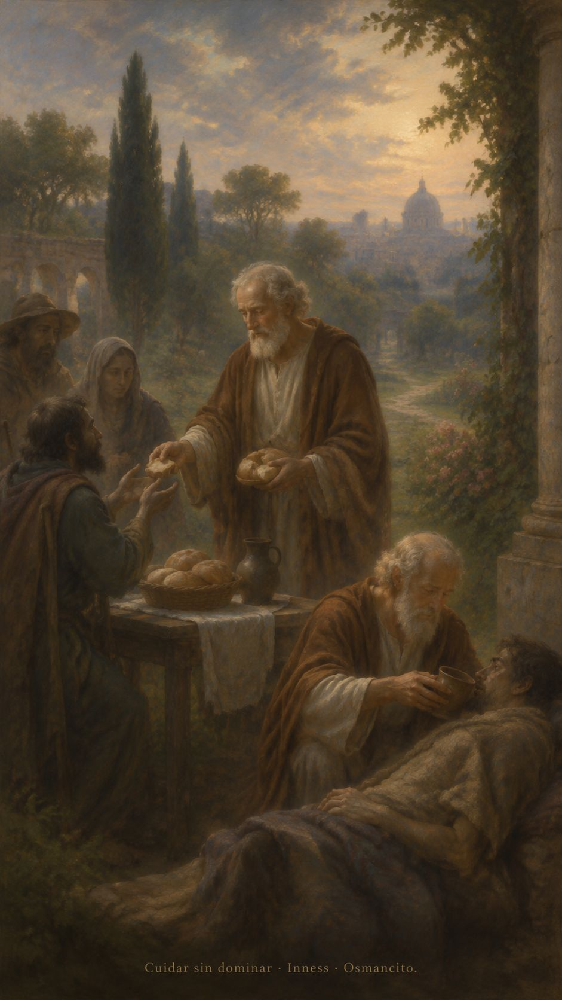

14 de octubre de 2026

_¡Buenos días!_

# El fruto paciente

**4**

> Si tenemos la vida del Espíritu, actuemos conforme a ese mismo Espíritu.

Gálatas 5,25. [Fuente](https://bible.usccb.org/es/bible/lecturas/101426.cfm)

_Que echemos raíces junto al agua que nos sostiene y demos fruto sin apurar las estaciones. Que la alegría no tape el dolor ajeno y la paz no sea una puerta cerrada. Que aprendamos a sostener las cargas que otros llevan, antes de añadirles una exigencia. Que la bondad tenga manos, la paciencia tenga tiempo y la justicia encuentre sitio en nuestros gestos. Que hoy dejemos menos peso y más sombra para quien venga detrás._

- El árbol junto al agua recoge el Salmo 1. Sus frutos compartidos remiten a Gálatas 5.

- La cesta sostenida entre varios responde a Lucas 11: las cargas no se alivian con órdenes, sino con ayuda.

**_¡Feliz miércoles 14 de octubre!_**

😊🙋‍♂

## San Calixto I, papa y mártir

[Lecturas de la memoria](https://bible.usccb.org/es/bible/lecturas/1014-memoria.cfm)

_Que cuidar no sea adueñarnos de nadie. Que recibamos a cada persona como una vida confiada, nunca como una posesión. Que el ejemplo pese más que la orden y la mesa tenga lugar para quienes llegan heridos. En la memoria de Calixto, que la autoridad aprenda a servir y nuestras manos se ofrezcan de buena gana, sin buscar recompensa._

- La escena de servicio recoge 1 Pedro 5 y Lucas 22: cuidar de buena gana, sin dominar.

**_¡Feliz memoria de san Calixto I!_**
