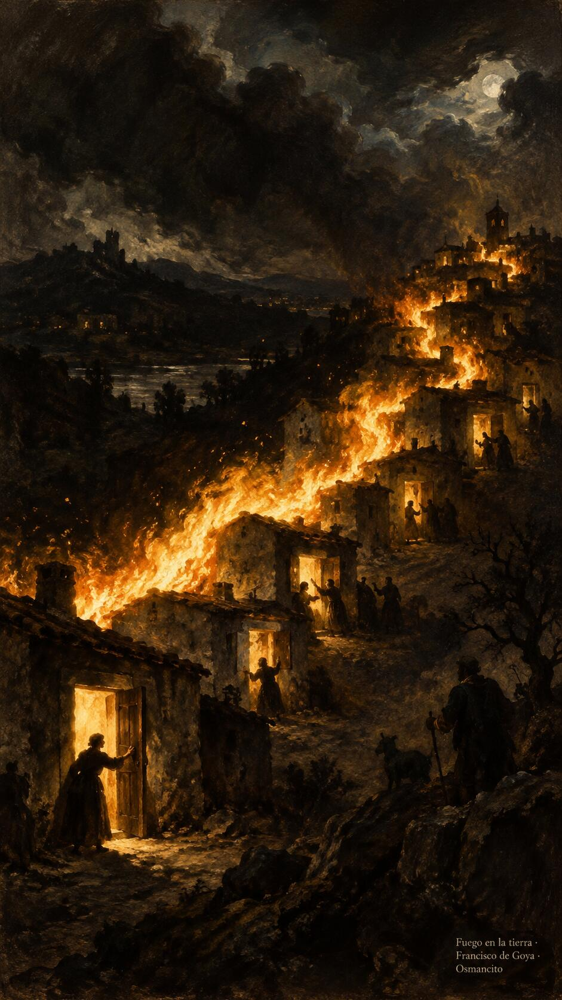
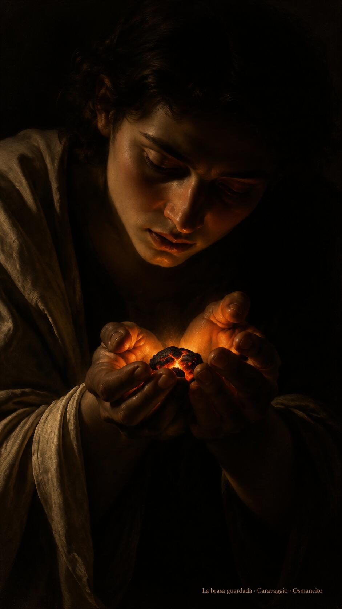
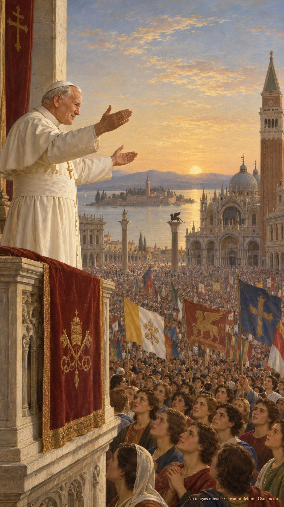

22 de octubre de 2026

_¡Buenos días!_

# El fuego deseado

**12**

> He venido a traer fuego a la tierra, ¡y cuánto desearía que ya estuviera ardiendo!

Lucas 12,49. [Fuente](https://bible.usccb.org/es/bible/lecturas/102226.cfm)

_Que el fuego de Cristo no se quede en metáfora tibia. Que arda en nosotros hasta quemar la pereza, el cálculo y la costumbre de enfriarlo todo. Que no tengamos miedo de la división que trae la verdad, ni nostalgia de la paz que era solo silencio. Que deseemos con él que la tierra ya esté ardiendo: cada casa una llama, cada corazón una brasa, cada palabra una chispa que no pide permiso para encender._

- El fuego que corre de casa en casa recoge Lucas 12: Cristo desea que la tierra ya esté ardiendo.

- Las manos que guardan la brasa encarnan el deseo que no se apaga.

**_¡Feliz jueves 22 de octubre!_**

😊🙋‍♂

## San Juan Pablo II, papa

[Lecturas de la memoria](https://bible.usccb.org/es/bible/readings/memoria-opcional-de-san-juan-pablo-ii-papa)

_Que no tengamos miedo de abrir de par en par las puertas a Cristo, como pidió Juan Pablo II la primera vez que habló a la Iglesia. Que su recuerdo nos devuelva la valentía de la esperanza: salir al encuentro, mirar a los jóvenes como él los miró y cansarnos de toda tibieza. Que su vida entera, ofrecida hasta la última palabra, nos enseñe que el amor no se jubila. Que oremos hoy con él por la paz del mundo._

- El papa de los brazos abiertos ante la multitud recuerda el no tengáis miedo de Juan Pablo II.

**_¡Feliz memoria de san Juan Pablo II!_**

© 2026 Osmancito
