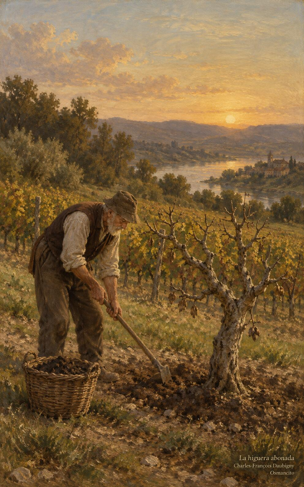
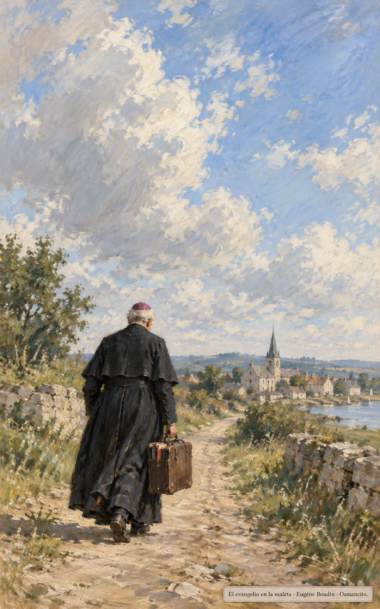

24 de octubre de 2026

_¡Buenos días!_

# Todavía este año

**14**

> Señor, déjala todavía este año; voy a aflojar la tierra alrededor y a echarle abono, para ver si da fruto.

Lucas 13,8. [Fuente](https://bible.usccb.org/es/bible/lecturas/102426.cfm)

_Que aprendamos del viñador que sabe esperar. Que no nos apure la cuenta de los años estériles ni nos tiente el hacha rápida del que solo mide frutos. Que aflojemos la tierra alrededor de lo que aún no da nada, y le echemos abono: paciencia, escucha, ternura. Que pidamos para cada rama seca un año más, y para nosotros la humildad de cultivar sin cosechar todavía, creyendo que la rama estéril puede algún día florecer._

- El viñador afloja la tierra y echa abono alrededor de la higuera seca: la paciencia de Lucas 13 pide un año más.

- Las manos viejas cobijan el brote nuevo que nace de la rama muerta: todavía este año puede florecer.

**_¡Feliz sábado 24 de octubre!_**

😊🙋‍♂

## San Antonio María Claret, obispo

[Lecturas de la memoria](https://bible.usccb.org/es/bible/lecturas/1024-memoria.cfm)

_Que la palabra sembrada en los libros viejos y en los caminos largos dé fruto todavía. En la memoria de Antonio María Claret, que gastó la vida llevando la buena noticia a las aldeas y multiplicándola en imprentas para que llegara más lejos, aprendamos a hacer camino con el evangelio en la maleta: predicar de muchas maneras, siempre, aunque sea por una sola. Que el celo por sembrar no se canse de inventar semillas nuevas._

- El obispo camina hacia la aldea llevando los libros en la maleta: Claret sembró la palabra por todos los caminos y las imprentas.

**_¡Feliz memoria de san Antonio María Claret!_**

© 2026 Osmancito
