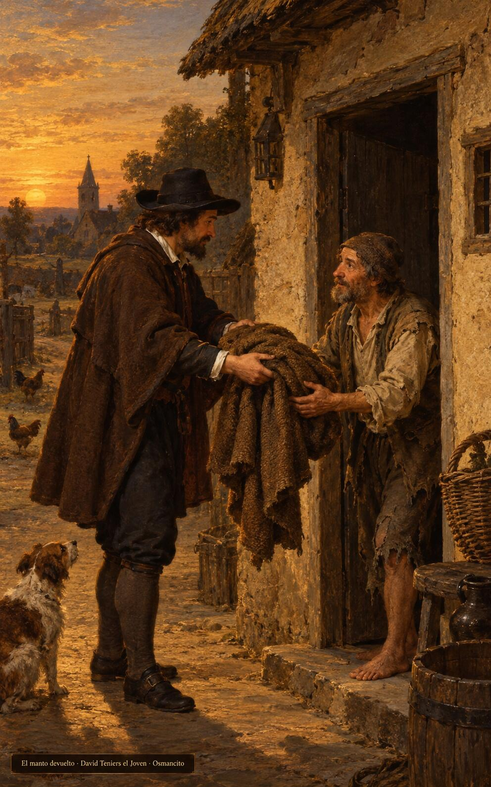
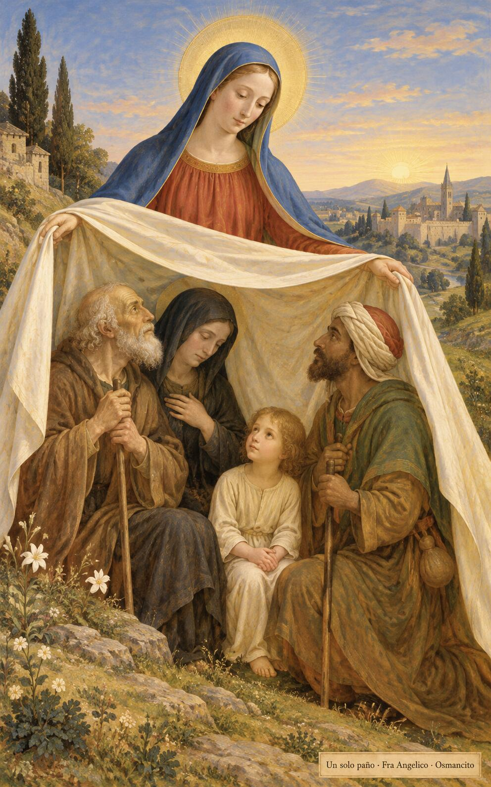

25 de octubre de 2026

_¡Buenos días!_

# El manto antes del sol

**15**

> Si tomas en prenda el manto de tu prójimo, devuélveselo antes de que se ponga el sol, porque no tiene otra cosa con qué cubrirse.

Éxodo 22,26. [Fuente](https://bible.usccb.org/es/bible/lecturas/102526.cfm)

_Que el amor a Dios no se nos quede en el techo del templo: baje a la puerta donde el extranjero espera y la viuda cuenta sus monedas. Que devolvamos el manto antes de que se ponga el sol, porque nadie duerme bajo nuestra deuda. Que amemos al prójimo como a nosotros mismos, no desde lejos, sino con las manos, y que en esos dos amores, que son uno, se sostenga nuestra manera de vivir._

- Al ponerse el sol, el prestamista devuelve el manto en el umbral de la casa humilde: Éxodo 22 pide que nadie duerma sin su cobertor.

- Quien extiende el manto cubre con un mismo paño al anciano, a la viuda, al niño y al caminante extranjero: los dos amores son una sola cobija.

**_¡Feliz domingo 25 de octubre!_**

😊🙋‍♂

© 2026 Osmancito
