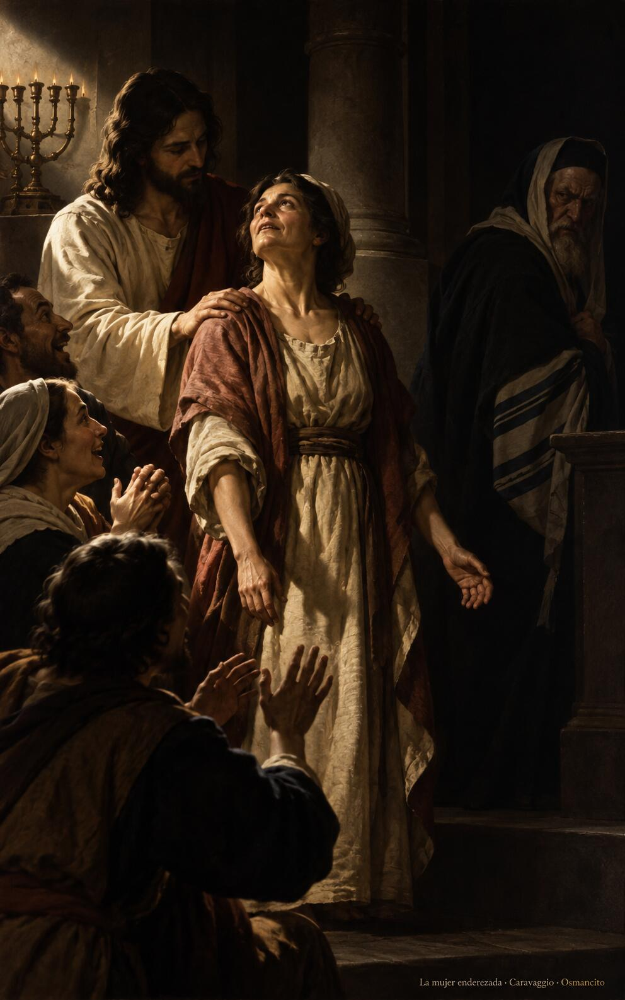
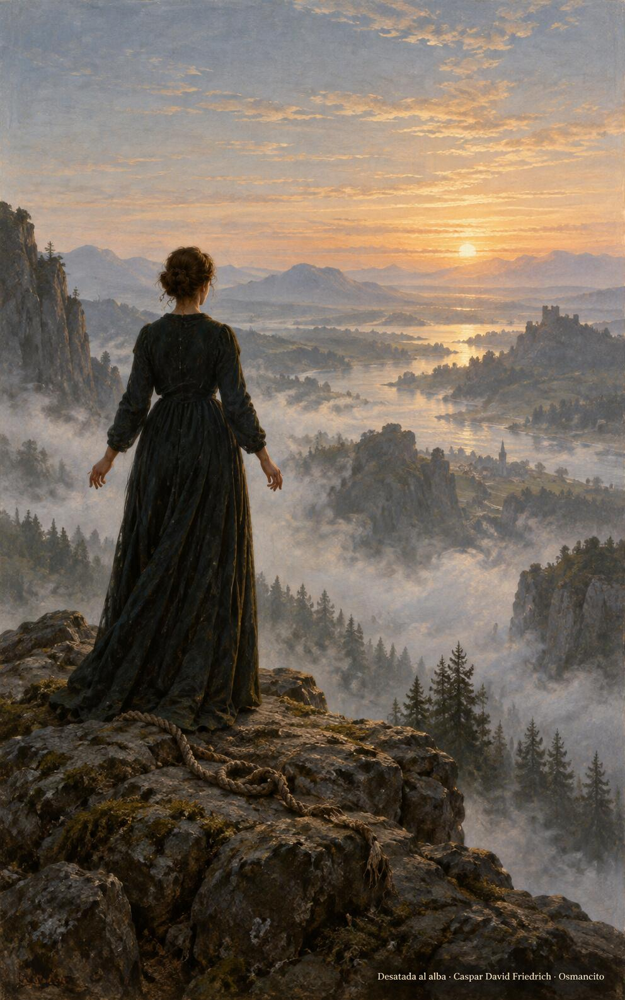

26 de octubre de 2026

_¡Buenos días!_

# Hijos de la luz

**16**

> En otro tiempo ustedes fueron tinieblas, pero ahora, unidos al Señor, son luz. Vivan, por lo tanto, como hijos de la luz.

Efesios 5,8. [Fuente](https://bible.usccb.org/es/bible/lecturas/102626.cfm)

_Que seamos hijos de la luz y lo parezcamos: gente que endereza lo que estuvo dieciocho años doblado. Que ningún reglamento nos cierre el puño cuando una hermana espera ser desatada, ni siquiera en sábado, ni con buenas razones. Que imitemos al Padre como hijos queridos: perdonando, dando gracias, plantados junto al río, y que nuestra luz no sea discurso sino manos que sueltan ataduras y dejan a la gente de pie, alabando a Dios._

- En la sinagoga, la mujer doblada dieciocho años se endereza al contacto de las manos; la gente se alegra y el indignado se aparta a la penumbra.

- Erguida ante el valle que amanece, la soga desatada yace a sus pies: la luz del amor suelta ataduras viejas.

**_¡Feliz lunes 26 de octubre!_**

😊🙋‍♂

© 2026 Osmancito
