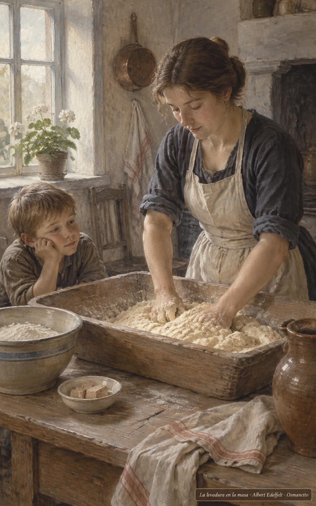
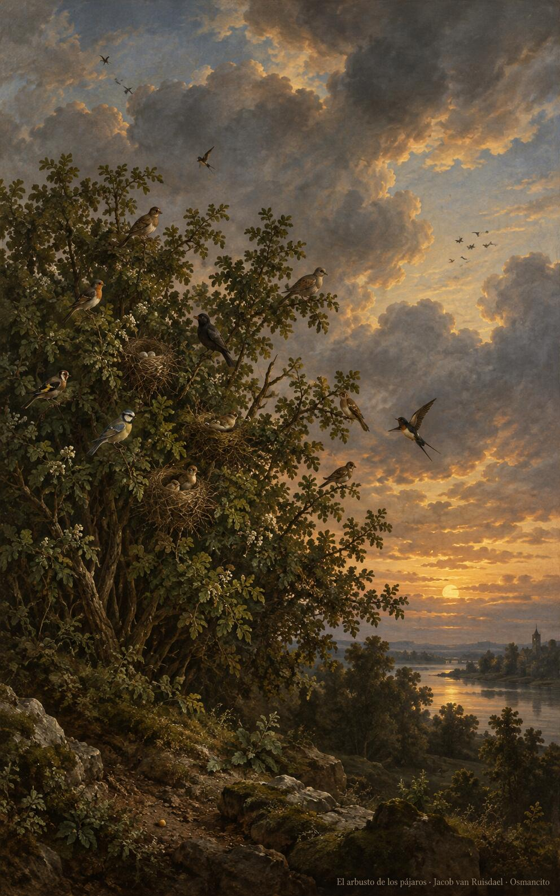

27 de octubre de 2026

_¡Buenos días!_

# Toda la masa

**17**

> ¿Con qué podré comparar al Reino de Dios? Con la levadura que una mujer mezcla con tres medidas de harina y que hace fermentar toda la masa.

Lucas 13,21. [Fuente](https://bible.usccb.org/es/bible/lecturas/102726.cfm)

_Que el Reino crezca en nosotros como la mostaza en la huerta: semilla mínima, casi nada, y de pronto arbusto donde anidan los pájaros. Que seamos levadura escondida en las tres medidas de harina, mujeres y hombres que fermentan la casa entera sin hacer ruido, respetándose por reverencia, amándose como cuerpo propio. Que lo pequeño no nos parezca poco: en lo escondido trabaja Dios, y la masa entera fermenta cuando la levadura cumple su oficio._

- La mujer mezcla la levadura en la artesa y el niño mira: el Reino trabaja escondido en la cocina de cada día.

- De la semilla mínima que quedó en la tierra nació el arbusto donde anidan los pájaros: lo pequeño se vuelve refugio de muchos.

**_¡Feliz martes 27 de octubre!_**

😊🙋‍♂

© 2026 Osmancito
