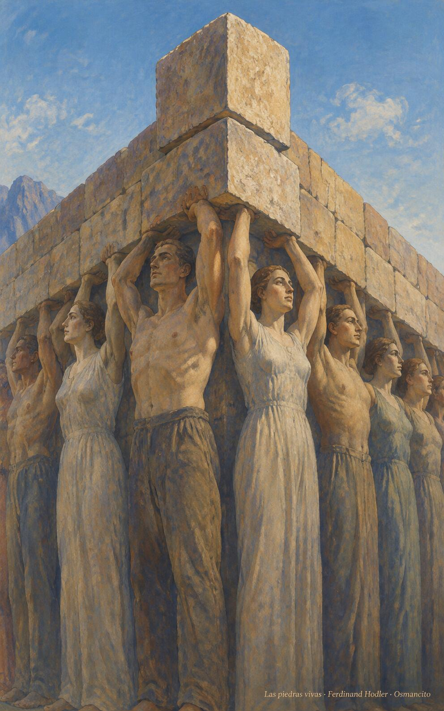
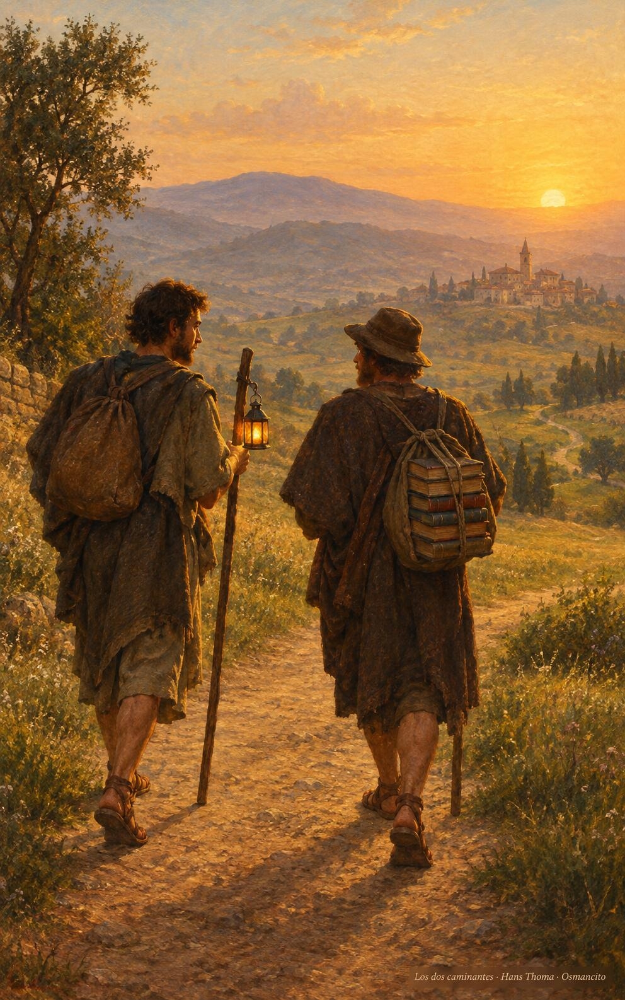

28 de octubre de 2026

_¡Buenos días!_

# Morada de Dios

**18**

> Ya no son ustedes extranjeros ni advenedizos; son conciudadanos de los santos y pertenecen a la familia de Dios.

Efesios 2,19. [Fuente](https://bible.usccb.org/es/bible/lecturas/102826.cfm)

_Que seamos piedras vivas de un edificio que se levanta sin ruido, bien estructurado sobre el cimiento de quienes creyeron primero. Que nadie se sienta extranjero en la casa: todos conciudadanos, todos familia. Que aprendamos de la noche en el monte: orar antes de elegir, quedarnos despiertos con Dios hasta que amanezca la decisión. Que el mensaje resuene sin palabras, de un día al otro, hasta el fin del mundo, y seamos morada para Dios._

- La oración de la noche entera en el monte recoge Lucas 6: antes de elegir a los doce, quedarse despierto con Dios hasta el alba.

- Hombres y mujeres son el cimiento que sostiene la casa y la piedra angular une los muros: Efesios 2, nadie es extranjero en la construcción.

**_¡Feliz miércoles 28 de octubre!_**

😊🙋‍♂

## Santos Simón y Judas, apóstoles

[Lecturas de la memoria](https://bible.usccb.org/es/bible/lecturas/102826.cfm)

_Que los nombres olvidados nos consuelen: Simón, el apasionado; Judas, el que preguntó con confianza. De ellos se sabe poco, y sin embargo sostienen el edificio: piedras del cimiento que nadie ve y todos pisan. Que aprendamos la grandeza de lo anónimo, la fidelidad que no pide retrato. Que llevemos juntos la buena noticia hasta el último rincón, y que en las causas imposibles nos acompañe su amistad, como una lámpara que no se apaga._

- Los dos apóstoles caminan juntos, uno con la lámpara encendida y otro con el fardo de libros: la buena noticia llevada hasta el último rincón.

**_¡Feliz día de los Santos Simón y Judas!_**

© 2026 Osmancito
