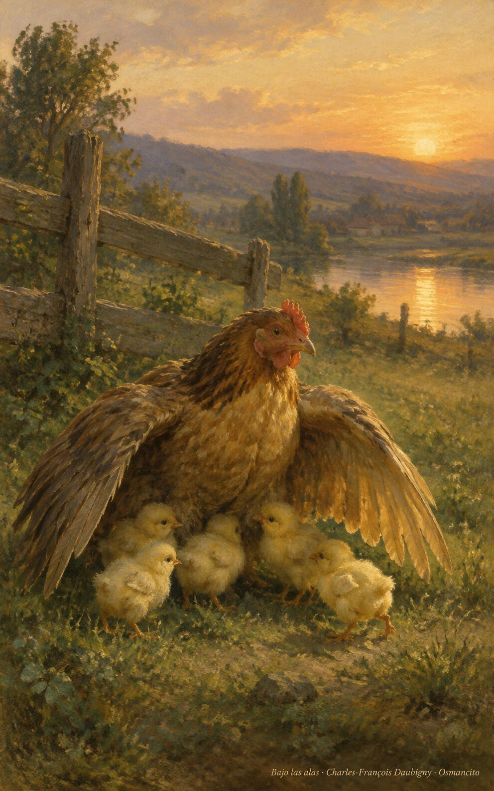
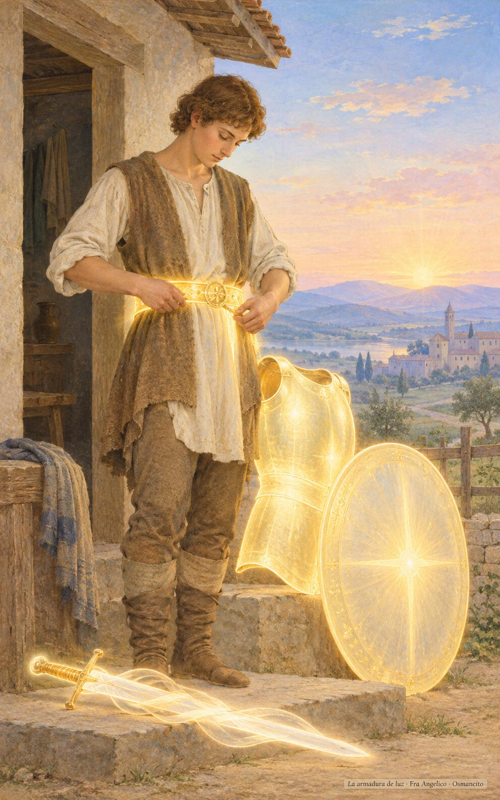

29 de octubre de 2026

_¡Buenos días!_

# Bajo las alas

**19**

> ¡Cuántas veces he querido reunir a tus hijos, como la gallina reúne a sus pollitos bajo las alas, pero tú no has querido!

Lucas 13,34. [Fuente](https://bible.usccb.org/es/bible/lecturas/102926.cfm)

_Que nos vistamos por dentro con la verdad como cinturón y la justicia como coraza, sin miedo a los zorros que amenazan. Que la fe sea escudo cuando vengan las flechas encendidas, y la palabra, espada que no hiere sino libera. Que sigamos el camino de hoy y de mañana, curando y expulsando sombras, hasta terminar la obra. Y que al final del día nos dejemos reunir como pollitos bajo las alas que nos quisieron._

- La gallina abre las alas y los pollitos corren a cobijarse: Lucas 13, el abrazo que Jerusalén no quiso.

- El campesino se viste al alba con cinturón, coraza, escudo y espada de luz: Efesios 6, las armas que Dios da para el día.

**_¡Feliz jueves 29 de octubre!_**

😊🙋‍♂

© 2026 Osmancito
