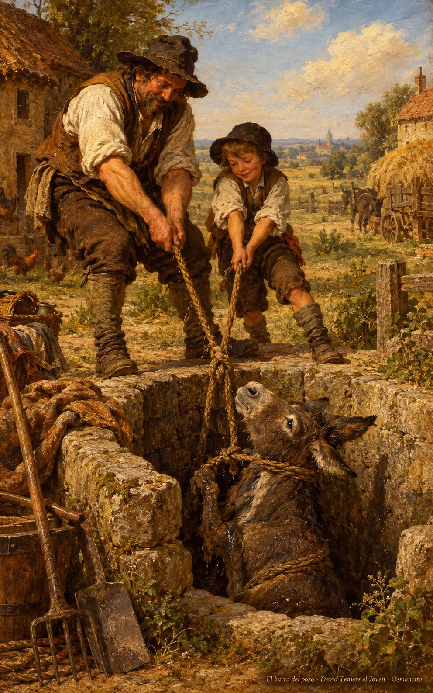
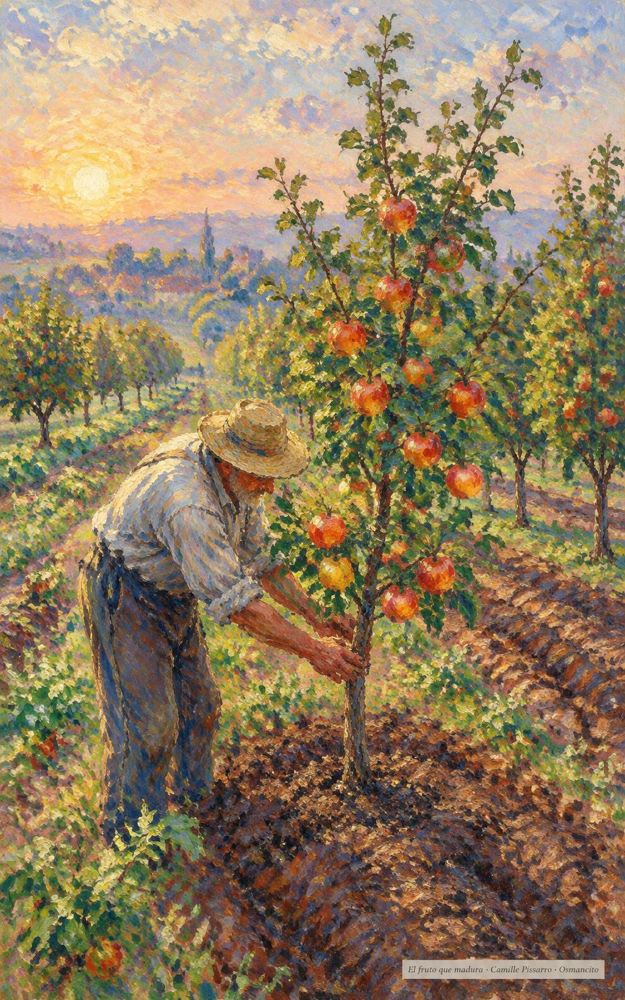

30 de octubre de 2026

_¡Buenos días!_

# El amor que crece

**20**

> Que su amor siga creciendo más y más y se traduzca en un mayor conocimiento y sensibilidad espiritual.

Filipenses 1,9. [Fuente](https://bible.usccb.org/es/bible/lecturas/103026.cfm)

_Que el amor no se estanque: que crezca cada día más en conocimiento y sensibilidad, hasta que sepamos escoger siempre lo mejor. Que la obra comenzada en nosotros siga perfeccionándose, como quien cultiva una planta con paciencia. Y que ninguna regla nos cierre el corazón: si el hermano cae al pozo, que lo saquemos enseguida, aunque sea sábado, aunque miren mal, porque la misericordia nunca está fuera de horario y su justicia dura para siempre._

- Padre e hijo tiran de la cuerda para sacar el burro del pozo: Lucas 14, nadie espera a que pase el sábado.

- El hortelano cultiva el árbol joven cargado de frutos al alba: Filipenses 1, la obra comenzada que sigue creciendo.

**_¡Feliz viernes 30 de octubre!_**

😊🙋‍♂

© 2026 Osmancito
