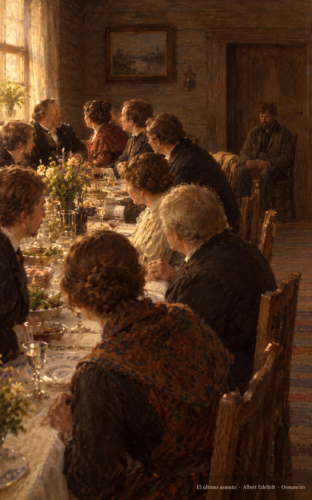
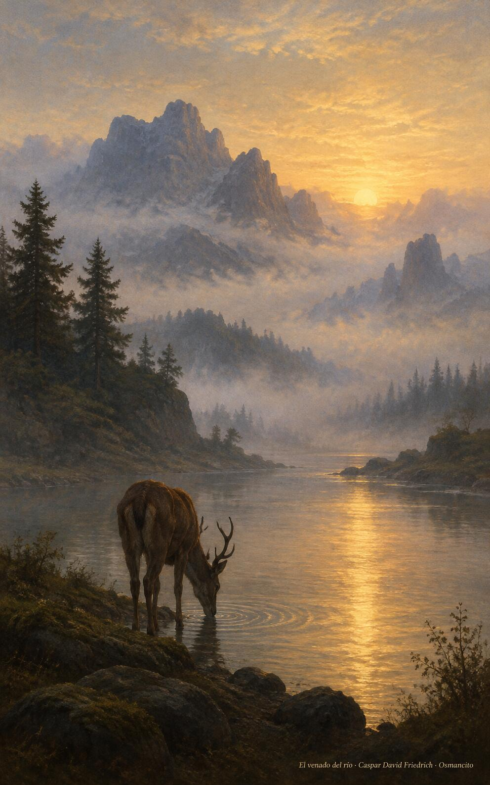

31 de octubre de 2026

_¡Buenos días!_

# El último lugar

**21**

> Mi alma te busca a ti, Dios mío.

Salmo 41,3. [Fuente](https://bible.usccb.org/es/bible/lecturas/103126.cfm)

_Que busquemos el agua viva como el venado busca el río, con el alma sedienta de lo único que sacia. Que escojamos el último lugar de la mesa y dejemos que sea otro quien nos acerque a la cabecera. Que la vida se nos vuelva servicio y la muerte ganancia, y que nada nos engrandezca tanto como agacharnos a levantar a quien viene detrás de nosotros, con la frente baja y el corazón alto, siempre._

- Los convidados disputan los primeros puestos y el hombre sencillo se sienta al fondo, junto a la puerta: Lucas 14, el último lugar espera a quien lo escoge.

- El venado bebe en el río al alba, frente a las montañas envueltas en niebla: Salmo 41, el alma que busca el agua viva.

**_¡Feliz sábado 31 de octubre!_**

😊🙋‍♂

© 2026 Osmancito
