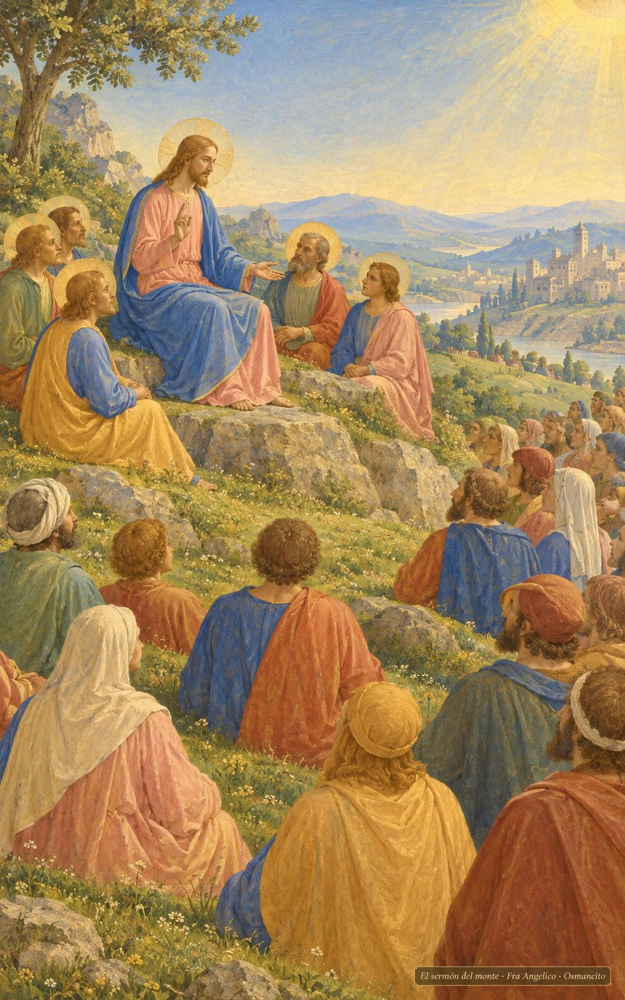
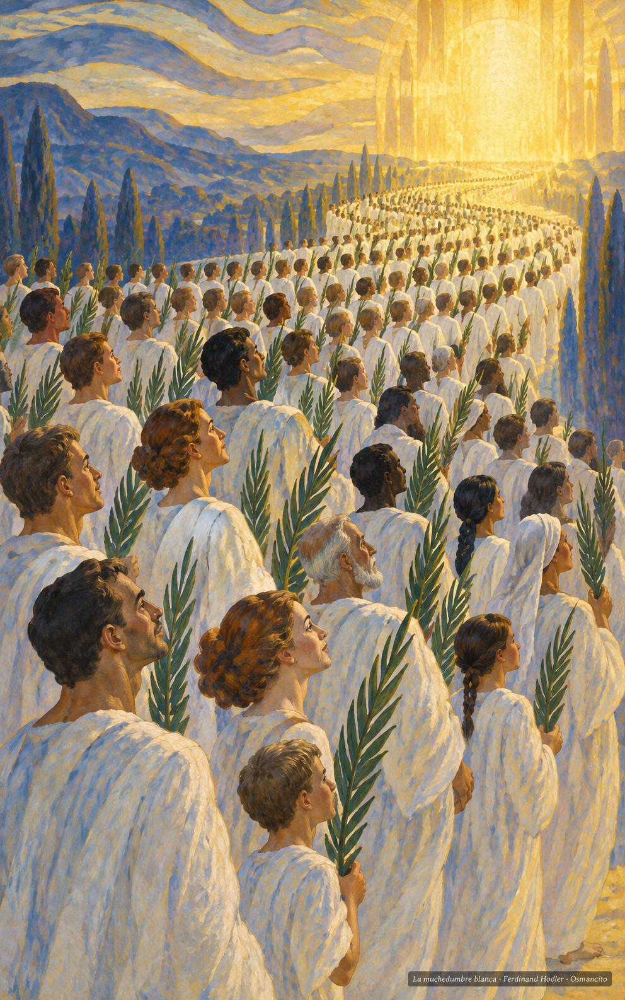
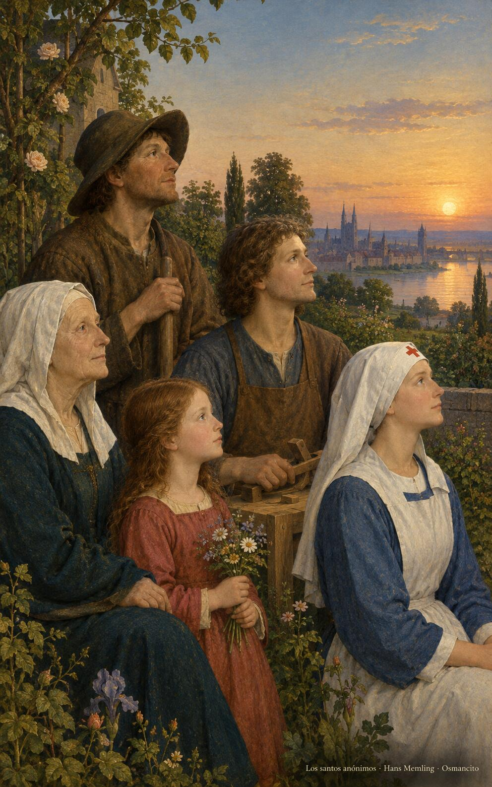

1 de noviembre de 2026

_¡Buenos días!_

# Los dichosos

**22**

> Dichosos los limpios de corazón, porque verán a Dios.

Mateo 5,8. [Fuente](https://bible.usccb.org/es/bible/lecturas/110126.cfm)

_Que aprendamos la dicha al revés del mundo: dichosos los pobres, los que lloran, los sufridos, los que tienen hambre de justicia. Que seamos limpios de corazón para ver a Dios y trabajemos por la paz hasta que nos llamen hijos suyos. Que nos vista la muchedumbre que nadie puede contar, con la túnica lavada y la palma en la mano, seguros de que lo veremos tal cual es, desde ya mismo y para siempre._

- Jesús se sienta en la ladera y enseña a la muchedumbre reunida a sus pies: Mateo 5, las bienaventuranzas dichas desde el monte.

- La muchedumbre incontable de túnicas blancas y palmas avanza hacia la luz: Apocalipsis 7, los que lavaron su túnica.

**_¡Feliz domingo 1 de noviembre!_**

😊🙋‍♂

## Solemnidad de Todos los Santos

[Lecturas de la memoria](https://bible.usccb.org/es/bible/lecturas/110126.cfm)

_Que la fiesta de todos los santos nos junte con los que ya llegaron: una muchedumbre de todas las naciones, sin nombre famoso, con la túnica blanqueada en la tribulación. Que nos consuele saber que la santidad no es uniforme ni rara: es la vida común llevada hasta el final con fidelidad. Que oigamos la llamada a ser hijos, y caminemos limpios de corazón hacia el rostro que nos espera, dichosos ya desde aquí abajo._

- La abuela, el campesino, la niña, el carpintero y la enfermera miran juntos hacia la luz: la santidad de la vida común, sin nombre famoso.

**_¡Feliz día de Todos los Santos!_**

© 2026 Osmancito
