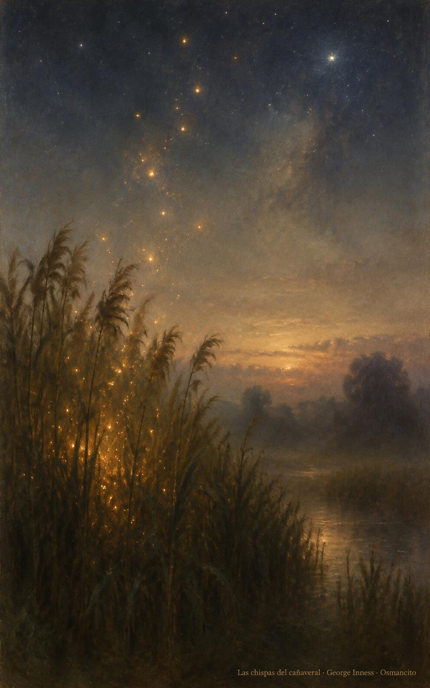
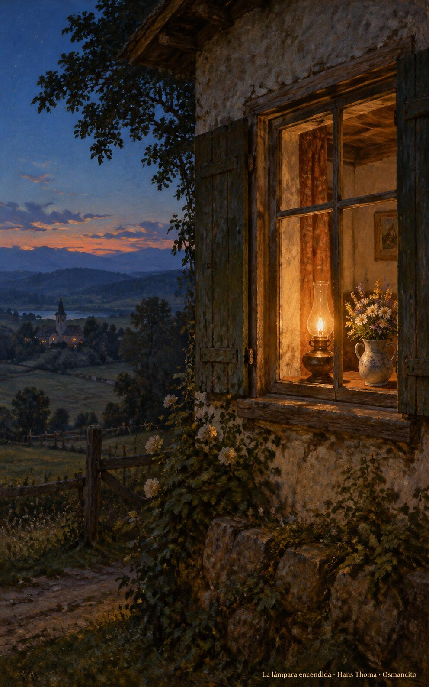

2 de noviembre de 2026

_¡Buenos días!_

# En las manos de Dios

**23**

> El Señor es mi pastor, nada me faltará.

Salmo 22,1. [Fuente](https://bible.usccb.org/es/bible/lecturas/110226.cfm)

_Que descansemos en las manos de Dios, donde ningún tormento alcance y la prueba purifique como el crisol al oro. Que el pastor nos guíe por cañadas oscuras sin miedo, con su vara y su cayado. Que la esperanza no defraude: nada se pierde de lo que el Padre entrega. Que brillemos como chispas en el cañaveral, despiertos para el último día, cuando todo lo entregado se levante a la vida que no se acaba._

- El pastor guía el rebaño por la cañada oscura hacia las praderas de luz: Salmo 22, el Señor es mi pastor, nada me faltará.

- Las chispas doradas suben del cañaveral hacia las estrellas: Sabiduría 3, los justos probados como oro en el crisol brillan en el día del juicio.

**_¡Feliz lunes 2 de noviembre!_**

😊🙋‍♂

## Conmemoración de Todos los Fieles Difuntos

[Lecturas de la memoria](https://bible.usccb.org/es/bible/lecturas/110226.cfm)

_Que la memoria de los que se fueron nos duela sin amargura: su salida no es destrucción, sino descanso en la paz de Dios. Que nuestro cariño los acompañe como una lámpara encendida en la ventana, y su ejemplo nos camine por dentro. Que pidamos por ellos como ellos pidieron por nosotros, seguros de que el amor permanece y nadie se pierde en las manos de Dios, ni en esta vida ni en la otra._

- La lámpara de aceite arde en la ventana junto a las flores: el cariño que acompaña a los que se fueron, encendido en la casa.

**_¡Feliz día de Todos los Fieles Difuntos!_**

© 2026 Osmancito
