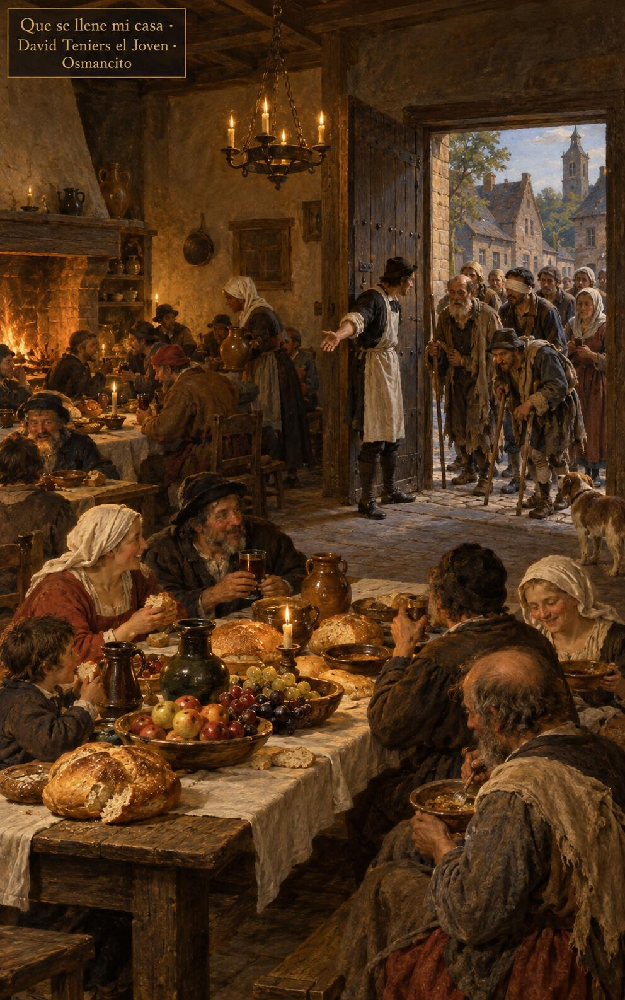
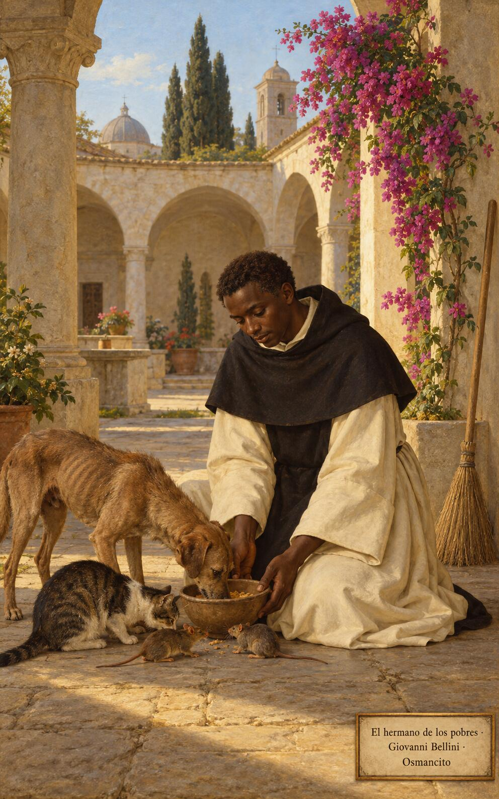

3 de noviembre de 2026

_¡Buenos días!_

# Todavía hay lugar

**24**

> Los pobres comerán hasta saciarse y alabarán al Señor los que lo buscan: su corazón ha de vivir para siempre.

Salmo 21,27. [Fuente](https://bible.usccb.org/es/bible/lecturas/110326.cfm)

_Que no nos aferremos a lo que somos: el que se anonadó fue exaltado, y toda rodilla se dobla ante su nombre. Que oigamos la invitación al banquete sin poner excusas de campos, bueyes o bodas. Que salgamos a las plazas y a los caminos a buscar a los pobres, los cojos y los ciegos, para que la casa se llene y los hambrientos coman hasta saciarse, y alabemos juntos al Señor que los busca._

- El criado abre la puerta del banquete a los pobres, los cojos y los ciegos: Lucas 14 manda salir a las plazas y a los caminos para que la casa se llene.

- La luz de la puerta abierta corre por senderos y veredas hasta el horizonte: la invitación alcanza los caminos más lejanos.

**_¡Feliz martes 3 de noviembre!_**

😊🙋‍♂

## San Martín de Porres, religioso

[Lecturas de la memoria](https://bible.usccb.org/es/bible/lecturas/1103-memoria.cfm)

_Que nos alegremos siempre, sin inquietarnos por nada, como el hermano Martín, que barrió, curó y compartió su plato con los más pobres. Que nuestro corazón no sea ambicioso, sino tranquilo como un niño en brazos de su madre. Que amemos a Dios con toda el alma y al prójimo como a nosotros mismos, y que en esa paz humilde se quede a vivir para siempre junto al Señor, paz de los pequeños y sencillos._

- El fraile comparte su escudilla con el perro, el gato y los ratones: Martín de Porres amó al prójimo hasta en las criaturas más pequeñas.

**_¡Feliz memoria de san Martín de Porres!_**

© 2026 Osmancito
