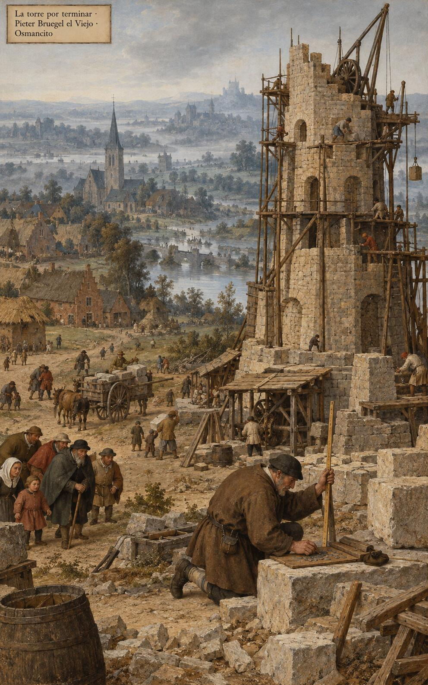
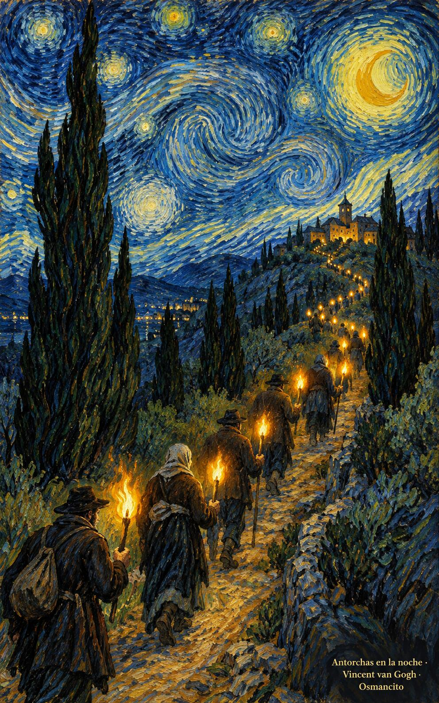
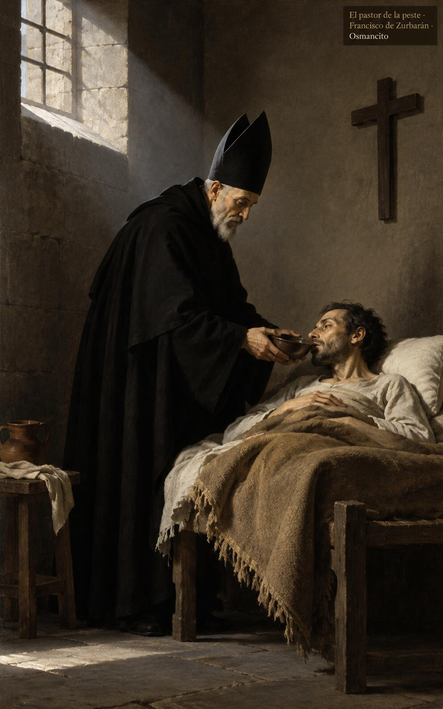

4 de noviembre de 2026

_¡Buenos días!_

# Antorchas en el mundo

**25**

> El Señor es mi luz y mi salvación, ¿a quién voy a tenerle miedo?

Salmo 26,1. [Fuente](https://bible.usccb.org/es/bible/lecturas/110426.cfm)

_Que trabajemos por nuestra salvación con humildad, sin quejas ni discusiones, sencillos y sin mancha en medio de este tiempo. Que antes de levantar la torre contemos las piedras y el costo, y antes de seguirlo calculemos qué dejamos: padre, madre, bienes, la propia vida. Que carguemos la cruz de cada día sin miedo, porque el Señor es nuestra luz y nuestra salvación, y brillemos como antorchas en la noche del mundo que las necesita._

- El hombre arrodillado cuenta las piedras junto a la torre a medio construir: Lucas 14 pide calcular el costo antes de empezar.

- Los caminantes suben de noche llevando cada uno su llama: Filipenses 2, brillarán como antorchas en el mundo.

**_¡Feliz miércoles 4 de noviembre!_**

😊🙋‍♂

## San Carlos Borromeo, obispo

[Lecturas de la memoria](https://bible.usccb.org/es/bible/lecturas/110426.cfm)

_Que la memoria de Carlos Borromeo nos enseñe a servir sin ruido: un pastor que visitó a los enfermos de la peste cuando otros huían, y gastó su vida corrigiendo con ternura lo torcido. Que cuidemos a los pequeños como él cuidó a los sembradores de la palabra. Que no nos pese darlo todo, porque quien brilla como antorcha no guarda la luz para sí, sino que la reparte hasta quedarse en nada y feliz._

- El obispo da de beber al enfermo en el catre pobre: Carlos Borromeo sirvió a los suyos cuando otros huían.

**_¡Feliz memoria de san Carlos Borromeo!_**

© 2026 Osmancito
