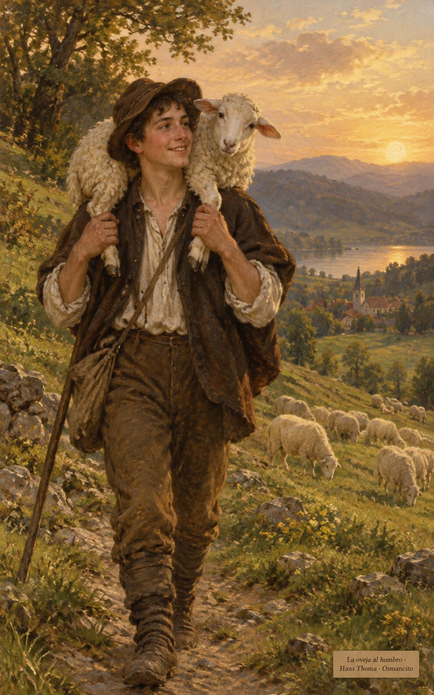

5 de noviembre de 2026

_¡Buenos días!_

# Cien ovejas y una

**26**

> El que busca al Señor será dichoso.

Salmo 104,3. [Fuente](https://bible.usccb.org/es/bible/lecturas/110526.cfm)

_Que no pongamos nuestra gloria en lo que se cuenta con los dedos, y consideremos ganancia solo aquello que vale de verdad. Que salgamos a buscar la oveja perdida, aunque queden noventa y nueve en el campo, y la carguemos sobre los hombros con alegría. Que encendamos la lámpara, barramos la casa y no descansemos hasta encontrar la moneda perdida, y que celebremos juntos cada encuentro, porque el cielo entero se alegra por quien vuelve._

- El pastor carga la oveja encontrada sobre los hombros y vuelve al rebaño: Lucas 15, la alegría de encontrar la que se había perdido.

- La mujer barre la casa a la luz de la lámpara hasta dar con la moneda: Lucas 15, el cielo se alegra por un solo pecador que se arrepiente.

**_¡Feliz jueves 5 de noviembre!_**

😊🙋‍♂

© 2026 Osmancito
