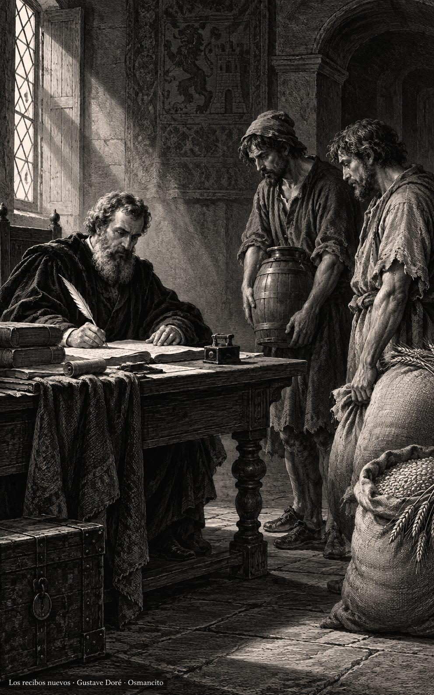
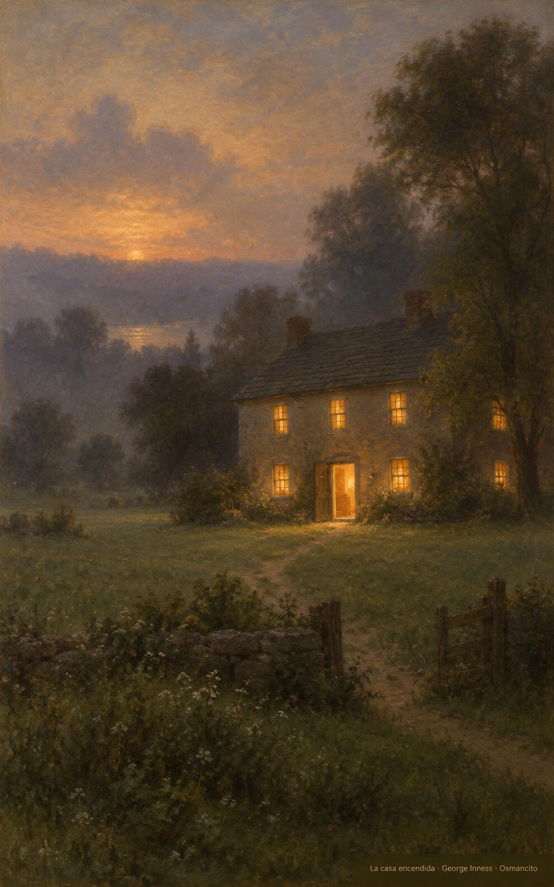

6 de noviembre de 2026

_¡Buenos días!_

# Amigos para mañana

**27**

> Vayamos con alegría al encuentro del Señor.

Salmo 121,1. [Fuente](https://bible.usccb.org/es/bible/lecturas/110626.cfm)

_Que seamos ciudadanos del cielo y no de la panza, fieles en lo puesto entre nuestras manos. Que rindamos cuentas con la frente alta y usemos los bienes para abrir puertas mañana: perdonemos deudas, hagamos amigos, preparemos la casa que nos reciba. Que no nos tome el despedido por sorpresa, sino despiertos y astutos para el bien, esperando con alegría al que viene a transformarnos, y mantengamos el corazón puesto en lo que no pasa._

- El administrador llama a los deudores y rehace los recibos: Lucas 16, la astucia que prepara el mañana.

- La casa encendida aguarda en el campo al caer la tarde: Filipenses 3, la ciudadanía que espera al que viene.

**_¡Feliz viernes 6 de noviembre!_**

😊🙋‍♂

© 2026 Osmancito
