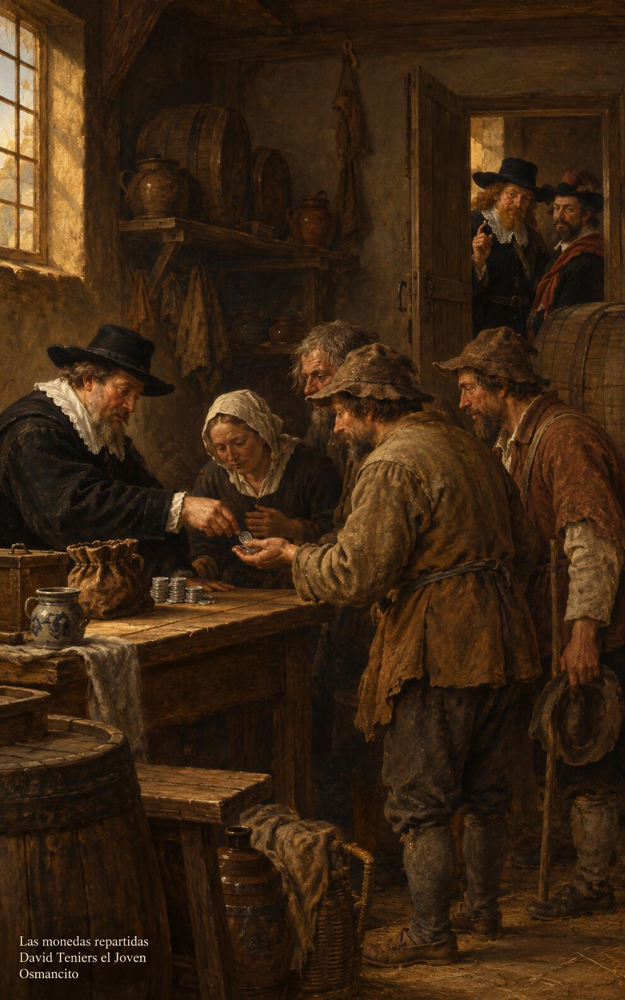

7 de noviembre de 2026

_¡Buenos días!_

# Fieles en lo pequeño

**28**

> Todo lo puedo unido a aquel que me da fuerza.

Filipenses 4,13. [Fuente](https://bible.usccb.org/es/bible/lecturas/110726.cfm)

_Que seamos fieles en lo pequeño: en la moneda prestada, en la mesa puesta, en la palabra dada. Que el dinero sirva y no mande, y lo conviertan nuestras manos en amigos que nos aguarden más allá. Que nos bastemos con lo que tenemos, fuertes en aquel que nos sostiene, y no nos encuentre nadie sirviendo a dos señores, sino libres, agradecidos y de corazón firme, con la frente alta y los bienes verdaderos esperándonos._

- El administrador reparte las monedas entre los pobres mientras dos amos lo llaman: Lucas 16, la fidelidad que no se parte.

- El caminante avanza ligero hacia la luz del alba y deja atrás las monedas: Filipenses 4, la fuerza que basta para todo.

**_¡Feliz sábado 7 de noviembre!_**

😊🙋‍♂

© 2026 Osmancito
