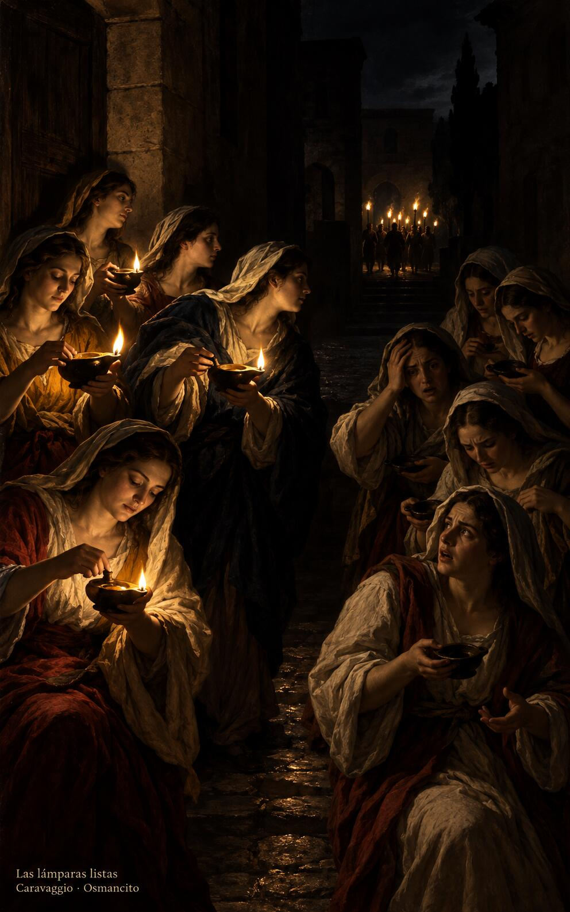
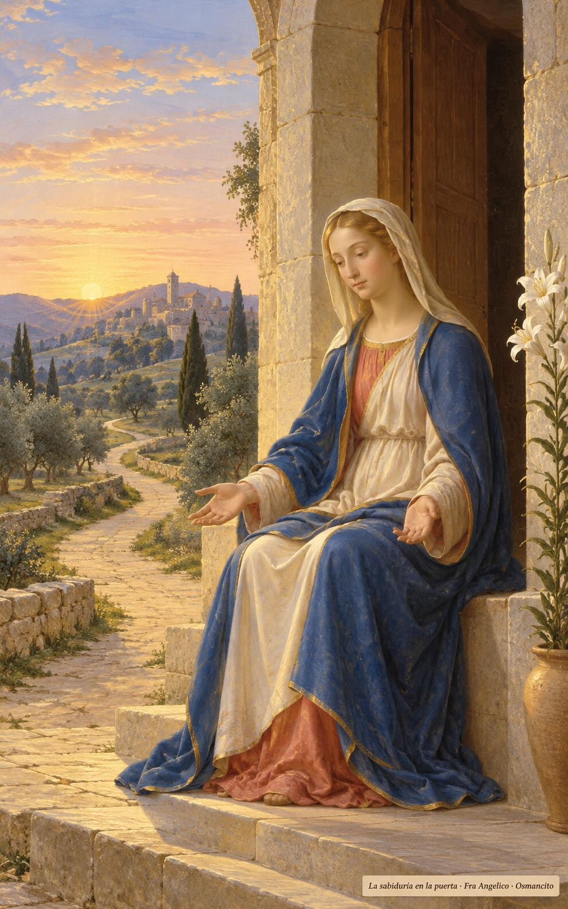

8 de noviembre de 2026

_¡Buenos días!_

# Lámparas en la noche

**29**

> Radiante e incorruptible es la sabiduría.

Sabiduría 6,12. [Fuente](https://bible.usccb.org/es/bible/lecturas/110826.cfm)

_Que madruguemos por la sabiduría y la hallemos sentada a la puerta. Que tengamos las lámparas listas y el aceite guardado, despiertos en la noche larga, sin saber el día ni la hora. Que no nos pese la espera ni nos duerma la costumbre: venga el esposo y nos encuentre de pie, con la mecha encendida y el corazón alegre, seguros de que los que se durmieron en él despertarán primero, y entremos al banquete._

- Cinco jóvenes avivan sus lámparas encendidas mientras las otras despiertan a oscuras: Mateo 25, la prudencia que no se compra a última hora.

- La sabiduría aguarda sentada en el umbral al primer resplandor: Sabiduría 6, la que sale al encuentro del que madruga.

**_¡Feliz domingo 8 de noviembre!_**

😊🙋‍♂

© 2026 Osmancito
