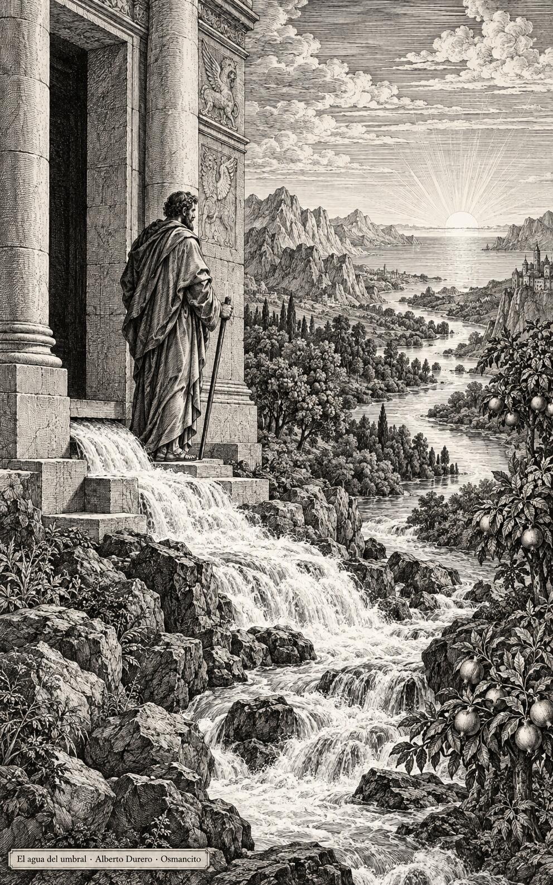
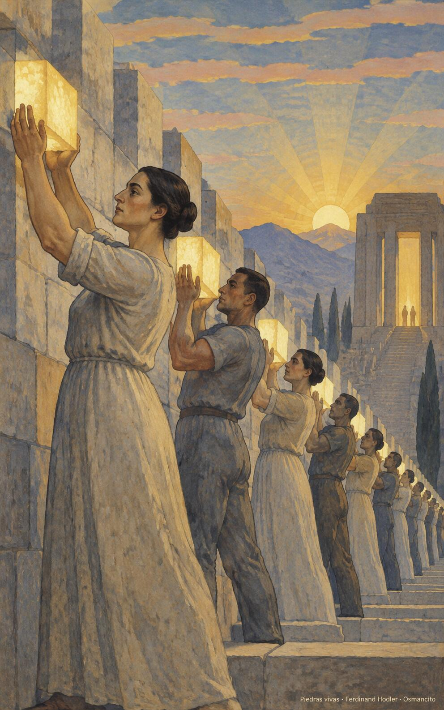
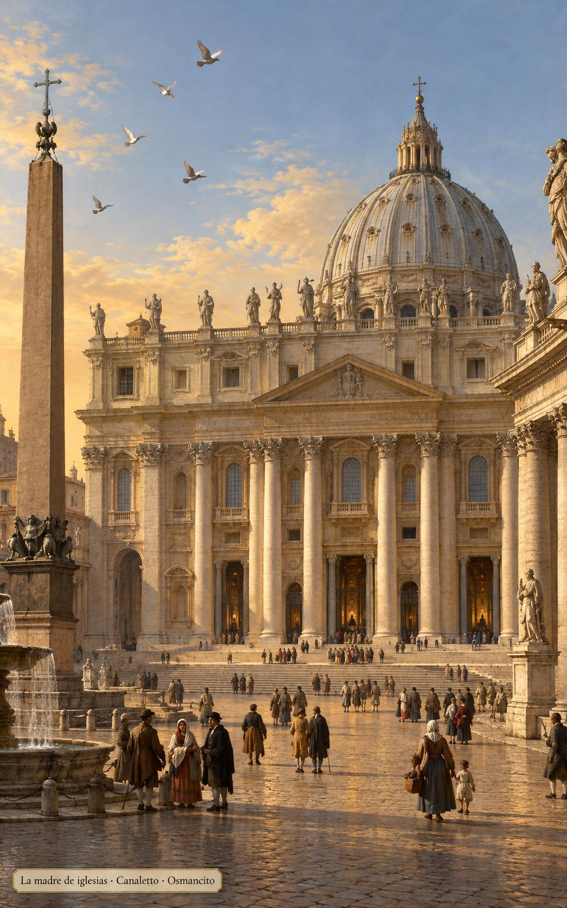

9 de noviembre de 2026

_¡Buenos días!_

# Un río que sana

**30**

> Un río alegra a la ciudad de Dios.

Salmo 45,5. [Fuente](https://bible.usccb.org/es/bible/lecturas/110926.cfm)

_Que seamos templo de Dios, edificados sobre el único cimiento, y deje el Espíritu habitar en nosotros. Que el agua que mana del umbral baje hasta nuestro mar amargo y salado y lo sane: que cuanto toque el torrente viva y dé fruto. Que no convirtamos la casa en mercado sino en oración y cuando la derriben confiemos en el que la levanta en tres días cuerpo vivo y verdadero entre nosotros hasta el fin._

- El agua que mana bajo el umbral del templo corre hacia oriente y da vida a los árboles de la orilla: Ezequiel 47, el torrente que sanea el mar.

- Los albañiles alzan cada uno una piedra de luz para el muro del templo: 1 Corintios 3, la casa que Dios edifica con nosotros.

**_¡Feliz lunes 9 de noviembre!_**

😊🙋‍♂

## Fiesta de la Dedicación de la Basílica de Letrán

[Lecturas de la memoria](https://bible.usccb.org/es/bible/lecturas/110926.cfm)

_Que celebremos la casa que precede a todas las casas: la de Letrán, madre de las iglesias, donde el nombre habita desde hace dieciséis siglos. Que no amemos las piedras por las piedras, sino al que las hace templo. Que nuestras puertas se abran como las suyas: que entre el pobre, el cansado, el que busca agua viva, y que en cada hogar que nos reúne se diga lo mismo: aquí habita Dios entre nosotros._

- La gente entra por las puertas abiertas de la basílica al dorarse la tarde: Letrán, la madre y cabeza de todas las iglesias.

**_¡Feliz día de la Dedicación de la Basílica de Letrán!_**

© 2026 Osmancito
