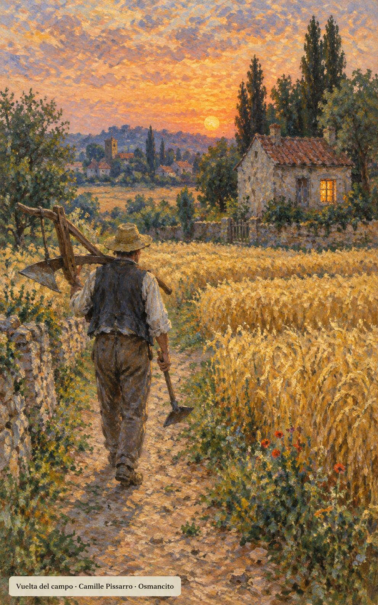

10 de noviembre de 2026

_¡Buenos días!_

# Servir sin medir

**31**

> Pon tu esperanza en Dios, practica el bien y vivirás tranquilo en esta tierra.

Salmo 36,3. [Fuente](https://bible.usccb.org/es/bible/lecturas/111026.cfm)

_Que sirvamos sin medir la medida: que labremos la tierra y pastemos el rebaño, y al volver del campo no pidamos asiento ni aplauso. Que la gracia nos enseñe a vivir sobrios, justos y en paz, tranquilos en esta tierra, dando buen ejemplo con obras sencillas y humildes. Que al caer la tarde podamos decir con alegría: solo hemos hecho lo que teníamos que hacer, y que la esperanza nos encuentre despiertos, sirviendo con gozo._

- Un campesino vuelve del campo con el arado al hombro hacia la casa encendida: Lucas 17, la jornada cumplida sin aplauso.

- Un caminante sigue la senda recta entre los sembrados hacia la luz del alba: Tito 2, la vida ordenada que enseña la gracia.

**_¡Feliz martes 10 de noviembre!_**

😊🙋‍♂

## San León Magno, papa y doctor de la Iglesia

[Lecturas de la memoria](https://bible.usccb.org/es/bible/lecturas/111026.cfm)

_Que seamos como León, el grande: pastor que salió al encuentro del invasor con la palabra por escudo, y toda Roma respiró aliviada. Que confesemos con claridad lo que creemos: un solo Señor, verdadero Dios y verdadero hombre. Que la palabra dicha a tiempo apague guerras y levante ánimos; que pastoreemos a quien tenemos cerca con ternura firme, y que nuestra grandeza sea servir, sin miedo y sin ruido, al que nos envía cada día._

- El anciano obispo detiene con la palabra al rey a caballo ante las murallas de Roma: san León Magno salió al encuentro de Atila.

**_¡Feliz memoria de san León Magno!_**

© 2026 Osmancito
