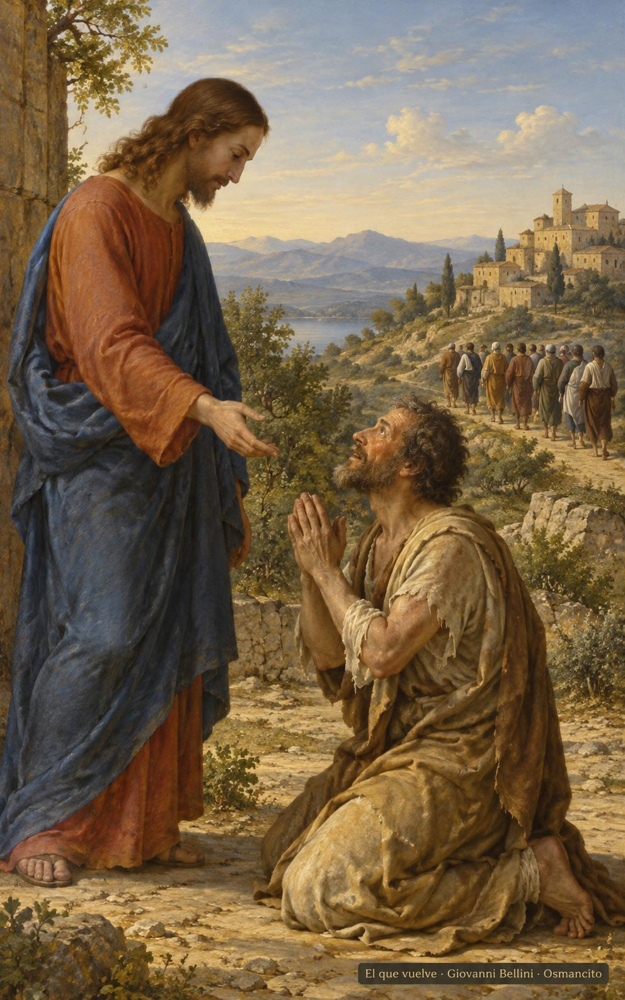
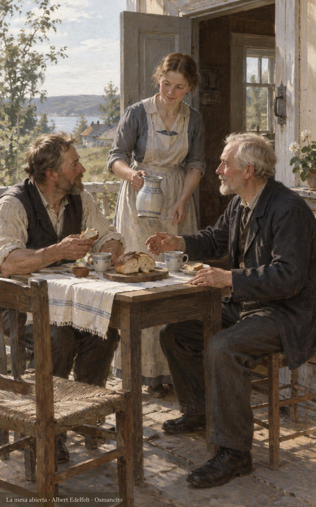
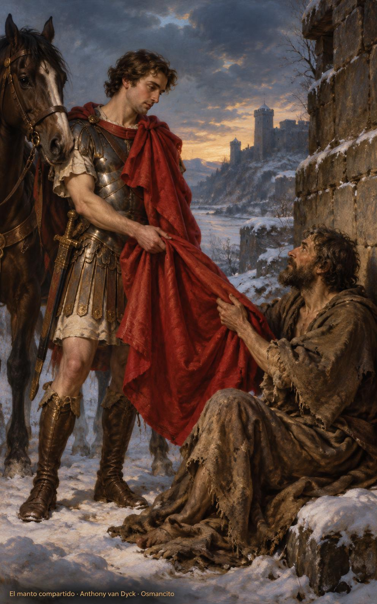

11 de noviembre de 2026

_¡Buenos días!_

# Volver a dar gracias

**32**

> El Señor es mi pastor, nada me falta.

Salmo 22,1. [Fuente](https://bible.usccb.org/es/bible/lecturas/111126.cfm)

_Que volvamos a dar gracias, como el extranjero que reconoce en su piel la vida recobrada. Que no pasemos de largo ante la bondad que nos levanta sin pedirnos méritos. Que dejemos los pleitos y tratemos a todos con amabilidad. Que encontremos descanso junto al agua tranquila y compartamos la mesa aun con quienes nos contradicen. Que nuestra alegría tenga memoria: que sepamos de dónde viene el bien y a quién ofrecerlo con manos abiertas._

- El samaritano vuelve y se arrodilla para dar gracias mientras los otros siguen su camino: Lucas 17,11-19.

- La mesa compartida y la puerta abierta hacen visible la bondad que recibe y reconcilia: Tito 3 y Salmo 22.

**_¡Feliz miércoles 11 de noviembre!_**

😊🙋‍♂

## San Martín de Tours, obispo

[Lecturas de la memoria](https://bible.usccb.org/es/bible/lecturas/111126.cfm)

_Que compartamos el manto como Martín, sin esperar a que termine el invierno ni a que nos sobre abrigo. Que reconozcamos en el cuerpo que tiembla a quien nos sale al encuentro. Que dejemos la espada quieta y hagamos sitio al pobre, al preso y al enfermo. Que la grandeza no nos aparte de la gente; que cuidemos sin palacios y llevemos en los hombros solamente lo que podamos partir para abrigar a otro hermano._

- Martín ofrece su manto al hombre que tiembla de frío: la compasión toma cuerpo en el abrigo compartido.

**_¡Feliz memoria de san Martín de Tours!_**

© 2026 Osmancito
