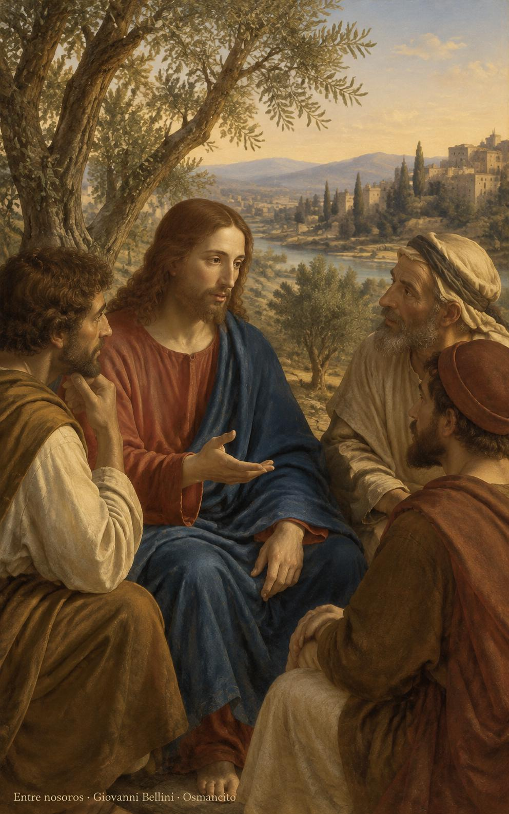
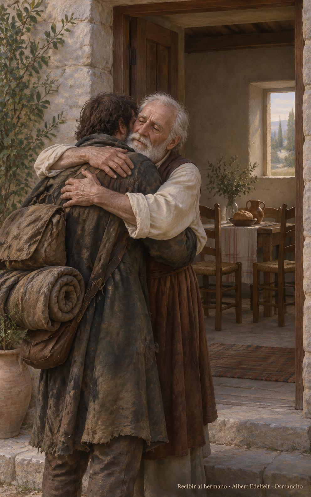
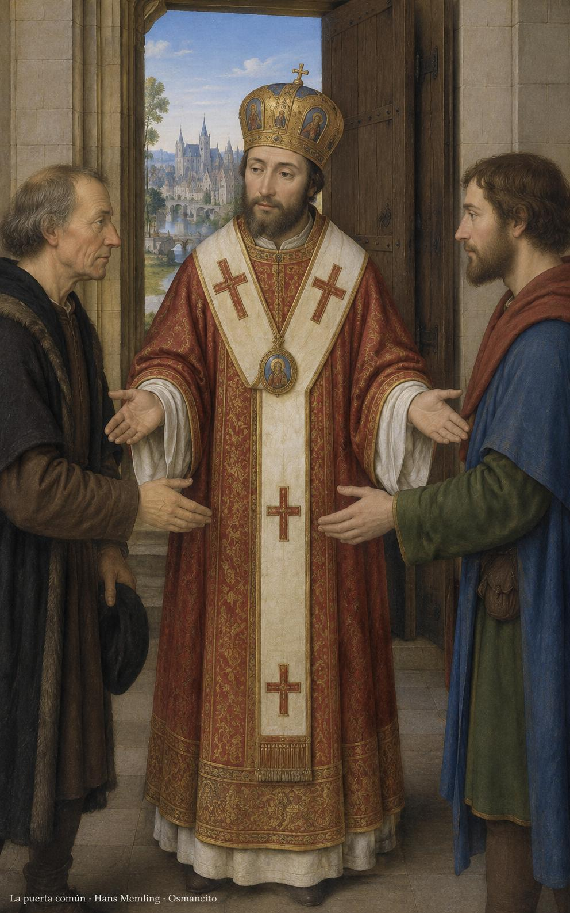

12 de noviembre de 2026

_¡Buenos días!_

# Entre nosotros

**33**

> El Reino de Dios ya está entre ustedes.

Lucas 17,21. [Fuente](https://bible.usccb.org/es/bible/lecturas/111226.cfm)

_Que no corramos detrás de anuncios ni busquemos lejos lo que crece entre nosotros. Que recibamos al que vuelve como hermano, sin cobrarle el pasado ni sentarlo más abajo. Que demos pan al hambriento y alivio al cansado. Que pidamos por amor lo que podríamos imponer por fuerza. Que aprendamos a reconocer la presencia de Dios en la mesa compartida, en la puerta abierta y en la dignidad que devolvemos a cada rostro cercano hoy._

- Jesús señala el círculo de quienes lo escuchan: Lucas 17, el Reino de Dios ya está entre ellos.

- El abrazo entre iguales, los dos asientos y el pan preparado: Filemón, recibir al que vuelve como hermano.

**_¡Feliz jueves 12 de noviembre!_**

😊🙋‍♂

## San Josafat, obispo y mártir

[Lecturas de la memoria](https://bible.usccb.org/es/bible/lecturas/111226.cfm)

_Que busquemos la unidad como Josafat, sin confundirla con el silencio del otro. Que guardemos la puerta abierta entre las casas separadas y aprendamos a escucharnos sin dejar de ser quienes somos. Que la firmeza no nos vuelva duros ni el miedo nos encierre. Que cuidemos la vida del vecino aun cuando rece con palabras distintas. Que prefiramos tender la mano a levantar el muro, y acompañemos con paz a quienes sufren por su fe._

- La puerta abierta y las manos tendidas encarnan la búsqueda de unidad de Josafat, sin borrar los rostros distintos.

**_¡Feliz memoria de san Josafat!_**

© 2026 Osmancito
