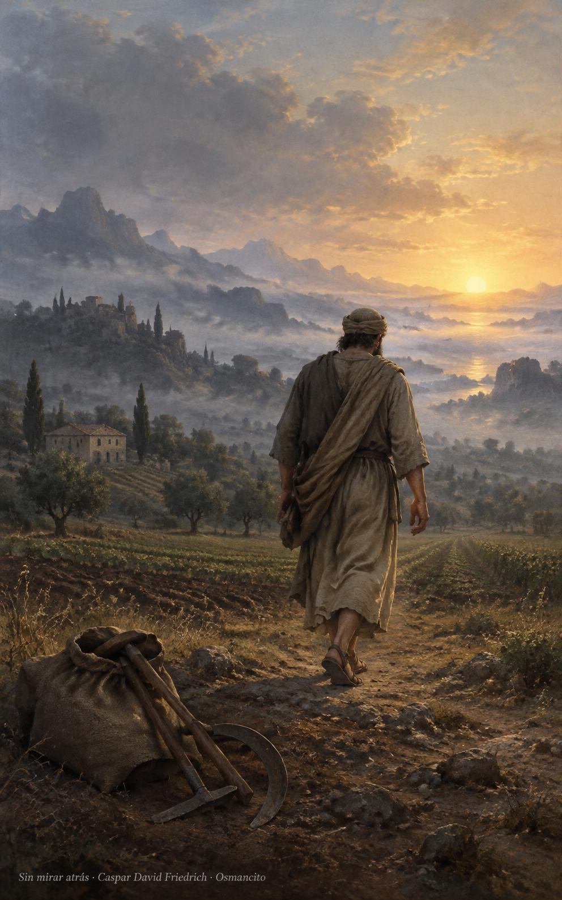
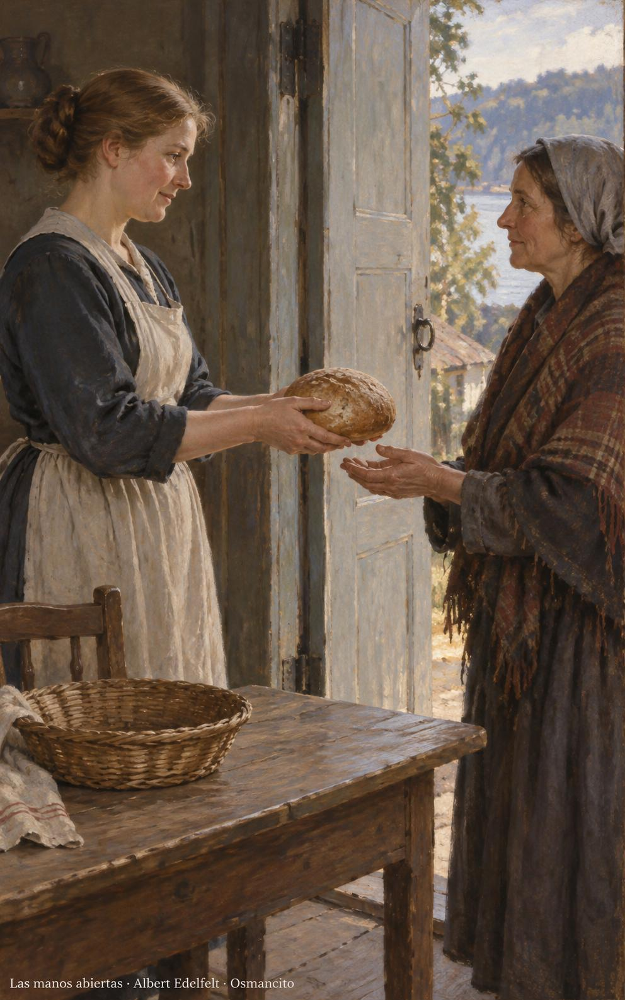
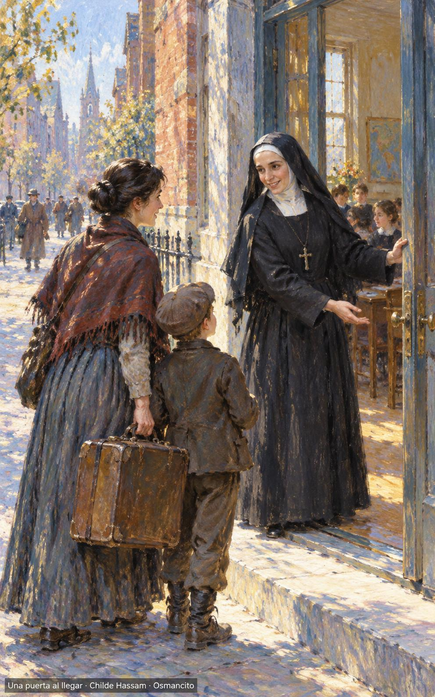

13 de noviembre de 2026

_¡Buenos días!_

# Las manos abiertas

**34**

> Ábreme los ojos para ver las maravillas de tu voluntad.

Salmo 118,18. [Fuente](https://bible.usccb.org/es/bible/lecturas/111326.cfm)

_Que caminemos en el amor sin dejarlo para mañana. Que abramos los ojos a las maravillas pequeñas y guardemos en el pecho la palabra que orienta nuestros pasos. Que no nos duerma la costumbre de comprar, sembrar y construir. Que sepamos soltar lo que pesa cuando llegue la hora de partir. Que no volvamos atrás por nuestras cosas y encontremos la vida al entregarla, con las manos abiertas y el corazón despierto junto al hermano._

- El campesino deja sus herramientas y sigue adelante sin volver la cabeza: Lucas 17, la vida que no se retiene.

- El único pan sale de las manos y la cesta queda vacía: amar es entregar la vida en un gesto cercano.

**_¡Feliz viernes 13 de noviembre!_**

😊🙋‍♂

## Santa Francisca Javier Cabrini, virgen

[Lecturas de la memoria](https://bible.usccb.org/es/bible/lecturas/111326.cfm)

_Que recibamos a quien llega como Francisca Cabrini, con una puerta abierta después del mar. Que no midamos la distancia antes de tender la mano ni pidamos al cansado que explique su pobreza. Que levantemos escuelas donde falten letras y cuidemos cuerpos donde duela el viaje. Que nuestra casa tenga sitio para otras voces. Que llevemos el amor a la calle y aprendamos del recién llegado a empezar de nuevo sin perder la esperanza compartida._

- Cabrini abre la escuela a una familia recién llegada con su maleta: el viaje encuentra acogida y lugar para aprender.

**_¡Feliz memoria de santa Francisca Javier Cabrini!_**

© 2026 Osmancito
