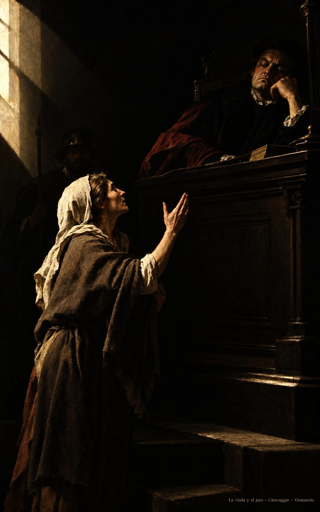
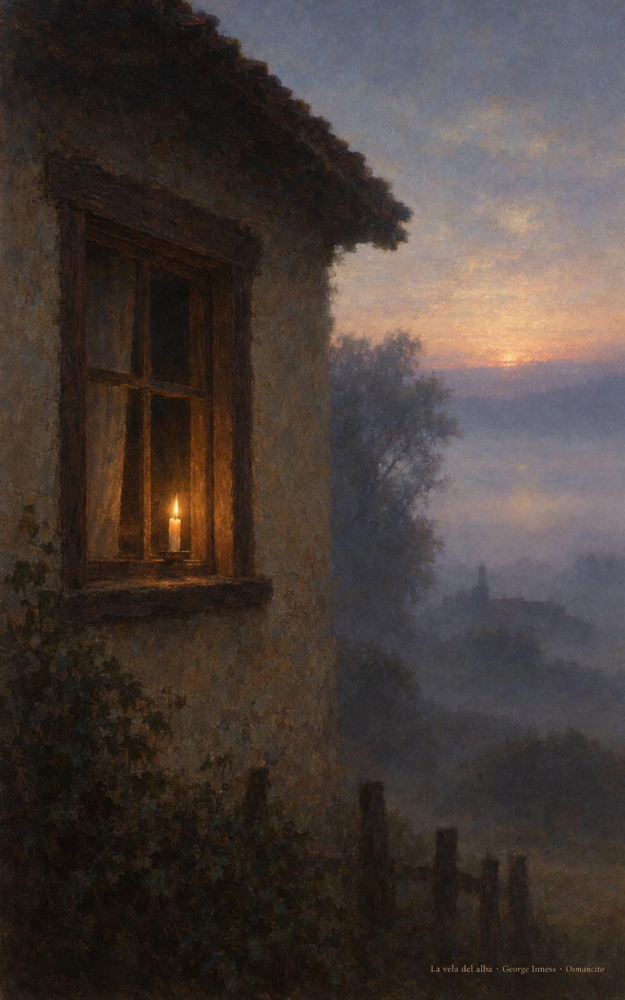

14 de noviembre de 2026

_¡Buenos días!_

# Clamar día y noche

**35**

> Es necesario orar siempre, sin desfallecer.

Lucas 18,1. [Fuente](https://bible.usccb.org/es/bible/lecturas/111426.cfm)

_Que oremos siempre y no nos cansemos de llamar. Que volvamos a la puerta cada mañana como la viuda que insiste, seguros de que alguien escucha detrás del muro. Que hagamos justicia sin tardar a quien clama de noche. Que ayudemos al hermano que pasa de camino y le demos lo que necesita para seguir. Que nuestra voz no se apague antes del alba y la fe nos encuentre despiertos, juntos, con la palabra encendida._

- La viuda sigue de pie ante el juez sentado y alza la mano una vez más: Lucas 18, pedir sin desfallecer.

- La vela sigue encendida en la ventana cuando ya clarea: la oración que no se apagó en la noche.

**_¡Feliz sábado 14 de noviembre!_**

😊🙋‍♂

© 2026 Osmancito
