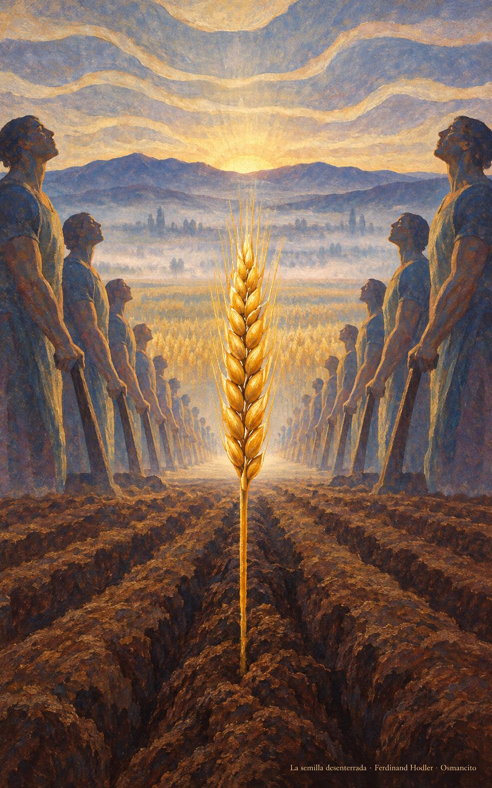

15 de noviembre de 2026

_¡Buenos días!_

# Desenterrar el talento

**36**

> Abre sus manos al pobre y las tiende al desvalido.

Proverbios 31,20. [Fuente](https://bible.usccb.org/es/bible/lecturas/111526.cfm)

_Que recibamos lo que se nos da como semilla buena y no como carga pesada. Que no enterremos por miedo el talento ni durmamos la espera como quien olvida la hora que llega. Que trabajemos con las manos hábiles y las abramos al pobre que pasa cerca de nosotros. Que seamos hijos de la luz, despiertos y sobrios, y al final del camino entreguemos multiplicado lo recibido, para entrar en la alegría que nos aguarda._

- Dos servidores presentan duplicado lo recibido y el tercero muestra su moneda aún con tierra: Mateo 25, la fidelidad que trabaja.

- La espiga crece del surco donde algo estuvo enterrado y se alza cargada de grano hacia el alba: lo confiado rinde cuando el miedo no manda.

**_¡Feliz domingo 15 de noviembre!_**

😊🙋‍♂

© 2026 Osmancito
