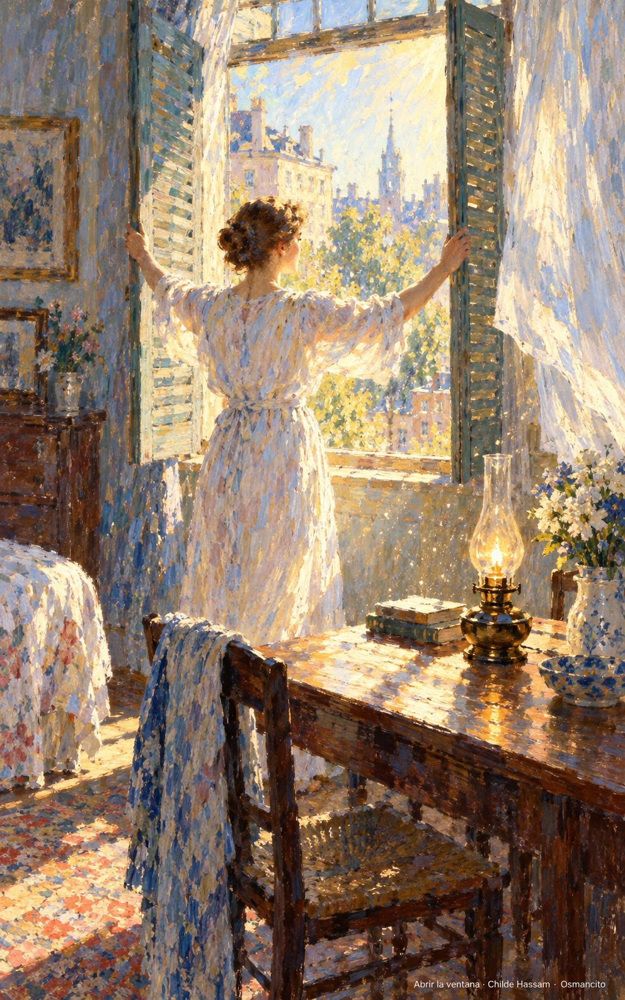
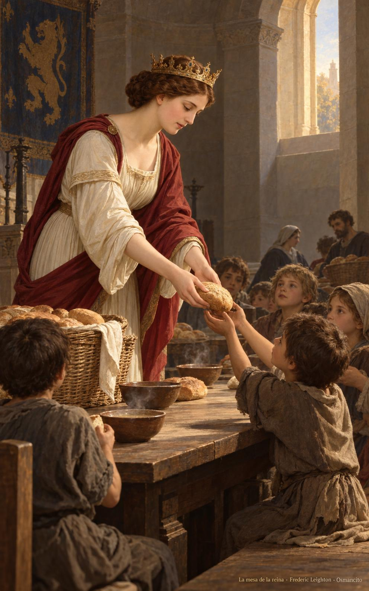
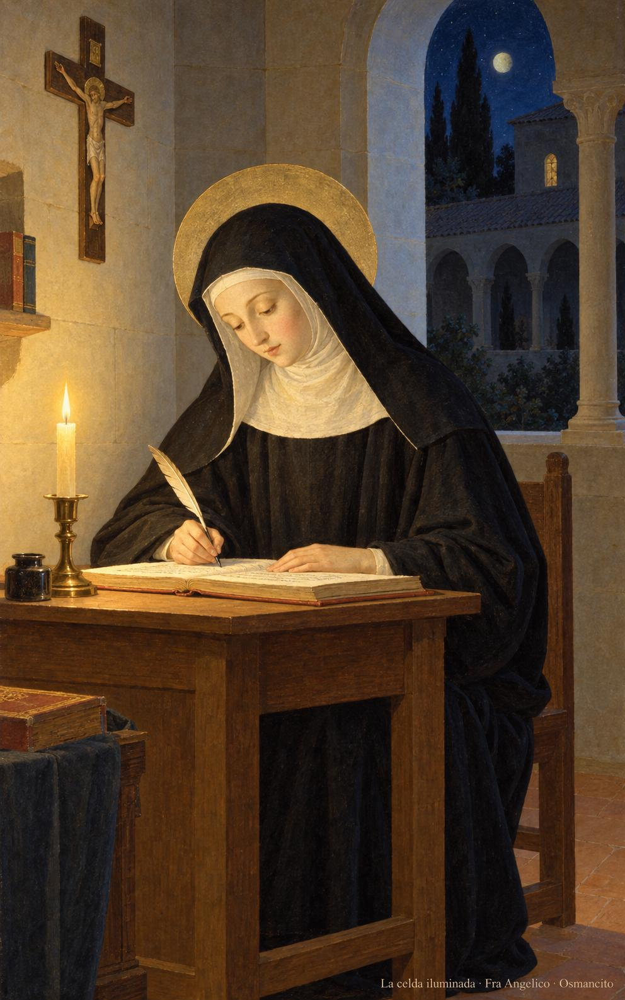

16 de noviembre de 2026

_¡Buenos días!_

# Volver a ver

**37**

> Señor, que vea.

Lucas 18,41. [Fuente](https://bible.usccb.org/es/bible/lecturas/111626.cfm)

_Que gritemos sin callarnos cuando la vida pase de largo, que pidamos ver con el corazón limpio y humilde. Que volvamos al primer amor, a la ternura del comienzo, y recordemos de dónde caímos. Que seamos un árbol plantado junto al río, que da su fruto a tiempo. Que la fe nos abra los ojos y sigamos el camino bendiciendo, despiertos, con la vista nueva puesta en la luz que nos llama desde el principio._

- El ciego alza la voz al borde del camino y Jesús se detiene ante él: Lucas 18, la fe que pide ver.

- Los postigos se abren y la luz de la mañana entra de golpe en la habitación: volver a ver es volver al primer amor.

**_¡Feliz lunes 16 de noviembre!_**

😊🙋‍♂

## Santa Margarita de Escocia

[Lecturas de la memoria](https://bible.usccb.org/es/bible/lecturas/1116a-memoria.cfm)

_Que hagamos de la casa una mesa abierta, como Margarita, que amasó su reino en pan partido. Que nadie toque nuestra puerta y se vaya con las manos vacías. Que sirvamos de rodillas, lavemos el cansancio ajeno y demos primero el mejor bocado. Que el poder que toquemos se vuelva cuidado, y la corona, costura de manteles limpios. Que reine en nosotros la ternura que gobierna sin mandar, y permanezca su dulce fruto para siempre._

- Margarita sirve el pan a los niños pobres en su propia mesa: la realeza se vuelve servicio cotidiano.

**_¡Feliz memoria de santa Margarita de Escocia!_**

## Santa Gertrudis, virgen

[Lecturas de la memoria](https://bible.usccb.org/es/bible/lecturas/1116b-memoria.cfm)

_Que busquemos la celda interior donde la voz pequeña habla, como Gertrudis entre los claustros. Que dejemos el ruido afuera y escuchemos hasta que el silencio florezca en palabra. Que permanezcamos en la vid, arraigados y cimentados en el amor, y demos fruto abundante. Que lo recibido en la noche lo escribamos de día para consuelo del hermano. Que el corazón sea lámpara encendida que no se apaga ni se cansa, y alumbre el camino._

- Gertrudis escribe de noche y la luz cae sobre el cuaderno: la oración escuchada se vuelve palabra.

**_¡Feliz memoria de santa Gertrudis!_**

© 2026 Osmancito
