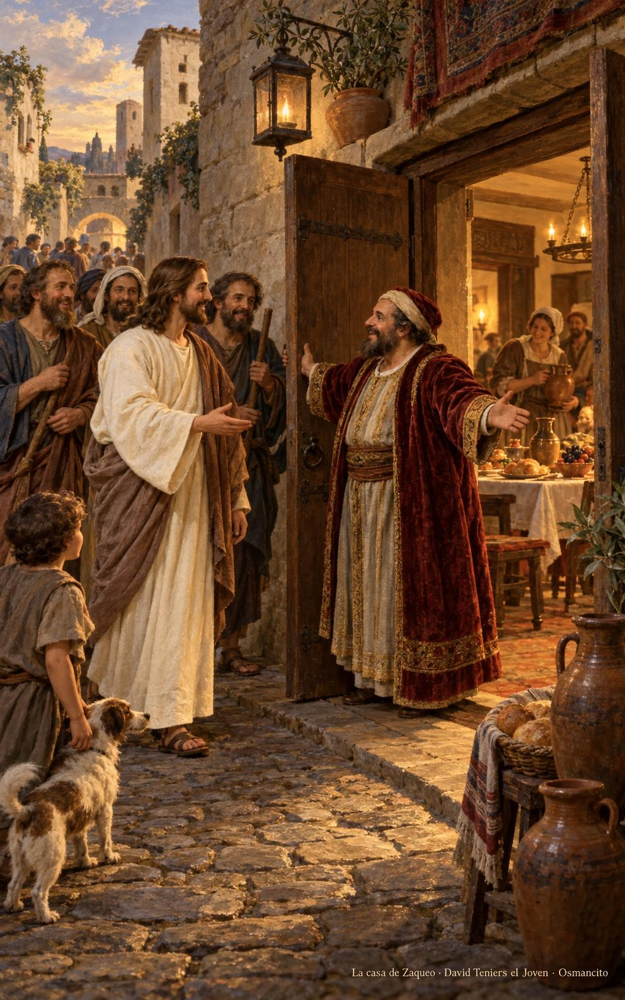
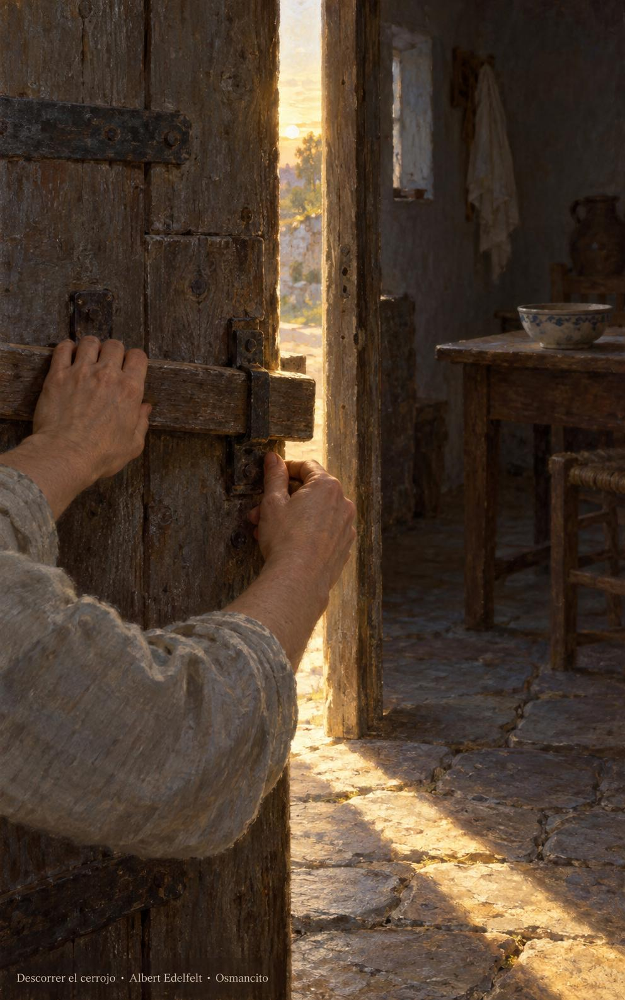
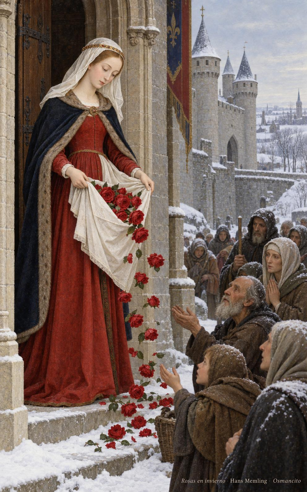

17 de noviembre de 2026

_¡Buenos días!_

# Abrir la puerta

**38**

> Mira que estoy aquí, tocando la puerta.

Apocalipsis 3,20. [Fuente](https://bible.usccb.org/es/bible/lecturas/111726.cfm)

_Que no seamos tibios ni nos creamos ricos sin necesidad de nada. Que escuchemos el golpe en la puerta y abramos sin demora, como Zaqueo, que bajó del árbol y recibió con alegría. Que devolvamos lo que no es nuestro y repartamos lo que nos sobra. Que la mesa se ponga para el que llega y la casa se llene de fiesta. Que el amor que llama nos encuentre despiertos, calientes, con el cerrojo corrido._

- Zaqueo abre de par en par la puerta de su casa y dentro la mesa ya está puesta: Lucas 19, la alegría de recibir al que llega.

- Las manos levantan el cerrojo de madera y la luz del amanecer entra por la rendija: abrirle al que toca es dejar de ser tibio.

**_¡Feliz martes 17 de noviembre!_**

😊🙋‍♂

## Santa Isabel de Hungría, religiosa

[Lecturas de la memoria](https://bible.usccb.org/es/bible/lecturas/1117-memoria.cfm)

_Que salgamos al encuentro del pobre como Isabel, con el pan caliente escondido en el delantal y la prisa buena de quien ama. Que las manos acostumbradas al bordado aprendan la llaga y la fiebre del enfermo. Que el invierno se vuelva rosas donde pasemos sirviendo cada día. Que ninguna puerta alta nos separe del que pide. Que nuestra vida, aunque corta, quede entera entregada, sembrada de mesas puestas y de enfermos visitados con gozo._

- El pan escondido se vuelve rosas en el delantal de Isabel: la leyenda del amor que no se deja esconder.

**_¡Feliz memoria de santa Isabel de Hungría!_**

© 2026 Osmancito
