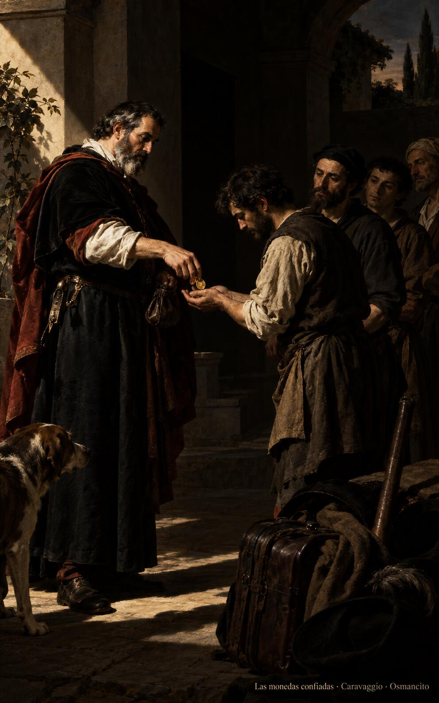
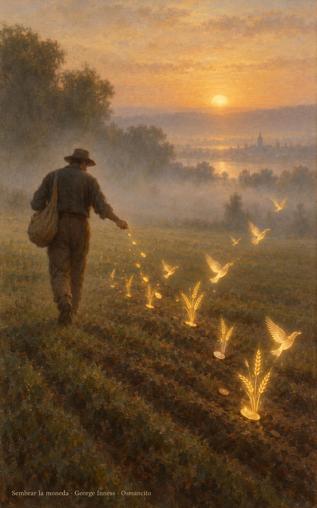
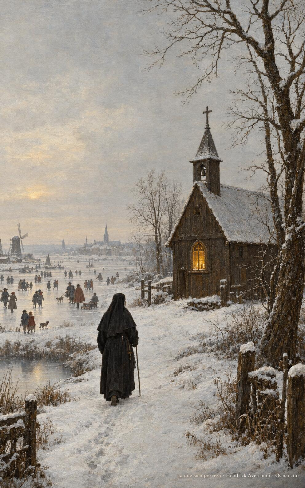

18 de noviembre de 2026

_¡Buenos días!_

# Invertir lo recibido

**39**

> Inviertan este dinero mientras regreso.

Lucas 19,13. [Fuente](https://bible.usccb.org/es/bible/lecturas/111826.cfm)

_Que abramos los ojos al trono que sostiene el cielo y reconozcamos que nada de lo que somos nos pertenece: toda moneda es prestada, toda corona vuelve a sus pies. Que no enterremos el don confiado; que lo hagamos fructificar con valentía en lo pequeño y cotidiano de cada día. Que toda la vida entera, con sus tambores y sus cuerdas y sus danzas, se vuelva una sola alabanza al que creó todas las cosas._

- Un señor reparte monedas de oro entre sus empleados antes de viajar y el primero las recibe con las manos abiertas: Lucas 19, el don que se recibe para hacerlo trabajar.

- Las monedas sembradas en el campo brotan como espigas y pájaros: lo confiado, puesto a trabajar sin miedo, se vuelve vida.

**_¡Feliz miércoles 18 de noviembre!_**

😊🙋‍♂

## Dedicación de las Basílicas de San Pedro y San Pablo, apóstoles

[Lecturas de la memoria](https://bible.usccb.org/es/bible/lecturas/1118a-memoria.cfm)

_Que seamos piedras vivas de una casa que no se levanta con mármoles sino con vidas entregadas. Recordemos a Pedro, que dudó sobre el agua y fue sostenido por una mano tendida, y a Pablo, que llegó encadenado a Roma y predicó el Reino sin estorbo alguno. Que la Iglesia que celebramos en muros siga siendo puerto abierto, mesa puesta y palabra libre, donde todo el que llegue encuentre hermanos que le salgan al encuentro._

- Pedro se hunde entre las olas de madrugada y la figura que camina sobre el agua le tiende la mano: Mateo 14, la duda sostenida.

**_¡Feliz memoria de la Dedicación de las Basílicas de San Pedro y San Pablo!_**

## Santa Rosa Filipina Duchesne, virgen

[Lecturas de la memoria](https://bible.usccb.org/es/bible/lecturas/1118b-memoria.cfm)

_Que imitemos a Rosa Filipina, que cruzó el mar de joven con un deseo grande y gastó su vida entera sembrando donde la tierra parecía no responder. Nos enseña que la oración perseverante no se mide en frutos visibles ni inmediatos: quien reza con constancia ya trabaja. Que aprendamos de ella a abrir escuelas del corazón, a querer sin rendirnos, a fiarlo todo a Aquel que llama y sostiene, y a envejecer diciendo todavía sí._

- La ventana encendida guía a la religiosa por la llanura nevada: la oración perseverante que no se apaga, aun cuando la tierra no responde.

**_¡Feliz memoria de santa Rosa Filipina Duchesne!_**

© 2026 Osmancito
