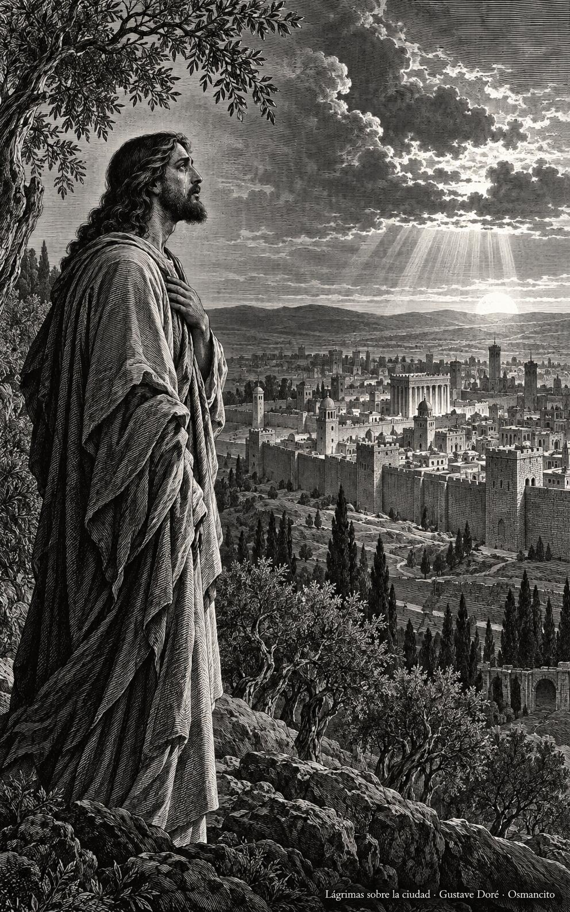
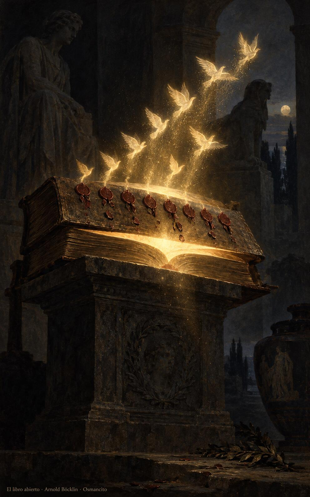

19 de noviembre de 2026

_¡Buenos días!_

# Reconocer la visita

**40**

> Ya no llores, porque ha vencido el león de la tribu de Judá.

Apocalipsis 5,5. [Fuente](https://bible.usccb.org/es/bible/lecturas/111926.cfm)

_Que no endurezcamos el corazón ni dejemos pasar la hora en que la paz se acerca a nuestra puerta. El libro sellado de nuestra historia ya tiene quien lo abra: el Cordero venció y convierte el llanto en cántico nuevo. Que reconozcamos la visita mientras es tiempo, que lloremos por lo que se pierde y nos alegremos por lo que se salva, y cantemos con arpas y tamboriles la victoria de los humildes y sencillos._

- Jesús contempla Jerusalén desde el monte con el rostro surcado de lágrimas: Lucas 19, el amor que llora por la ciudad que no reconoció su hora.

- Los siete sellos del libro se agrietan y dejan salir luz y pájaros: Apocalipsis 5, la historia cerrada ya tiene quien la abra.

**_¡Feliz jueves 19 de noviembre!_**

😊🙋‍♂

© 2026 Osmancito
