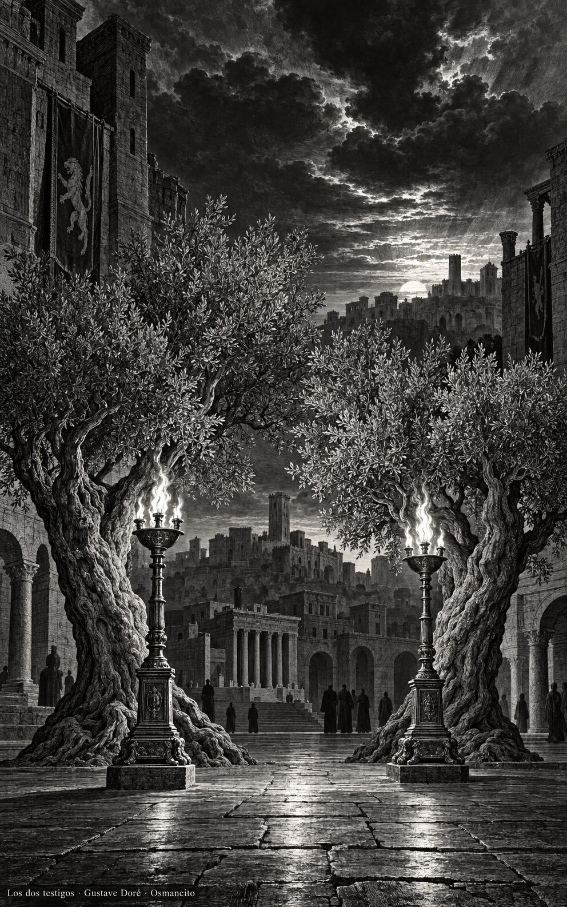
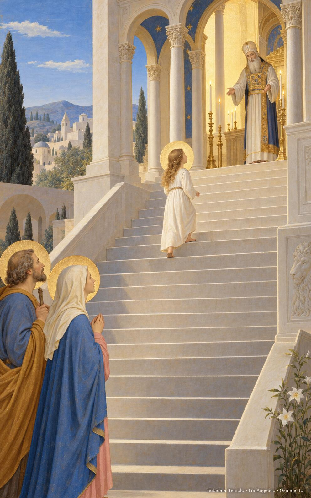

21 de noviembre de 2026

_¡Buenos días!_

# Dios de vivos

**42**

> Dios no es Dios de muertos, sino de vivos.

Lucas 20,38. [Fuente](https://bible.usccb.org/es/bible/lecturas/112126.cfm)

_Que seamos testigos de pie ante el Señor, olivos que no se rinden aunque la plaza quede tendida. Que la muerte no nos cierre la boca: que creamos que el que llama a Abraham, Isaac y Jacob no es Dios de muertos sino de vivos, y que para él todos vivamos. Que él sea nuestra roca y nuestro escondite, y que, juzgados dignos, resucitemos a la vida que no se acaba, hijos suyos para siempre._

- Los dos olivos y los dos candelabros siguen de pie en la plaza de la gran ciudad cuando cae la tarde: Apocalipsis 11, los testigos que no se rinden.

- El árbol desnudo se enciende en flor bajo la niebla mientras una figura lo contempla en silencio: Lucas 20, para Dios todos viven.

**_¡Feliz sábado 21 de noviembre!_**

😊🙋‍♂

## La Presentación de la Bienaventurada Virgen María

[Lecturas de la memoria](https://bible.usccb.org/es/bible/lecturas/1121-memoria.cfm)

_Que como María subamos los escalones del templo con la vida en las manos, niña entregada que se vuelva morada. Que Dios venga a vivir en medio de nosotros y nos tome como propiedad suya en tierra santa. Que el alma glorifique al Señor y el espíritu se llene de júbilo, porque mira la humildad de su esclava. Que escuchemos la palabra y la pongamos en práctica, y seamos su madre, su hermana, su familia._

- La niña sube sola los escalones del templo hacia la luz de las velas que la esperan: la Presentación de María, la vida entregada que se vuelve morada.

**_¡Feliz memoria de la Presentación de la Bienaventurada Virgen María!_**

😊🙋‍♂

© 2026 Osmancito
