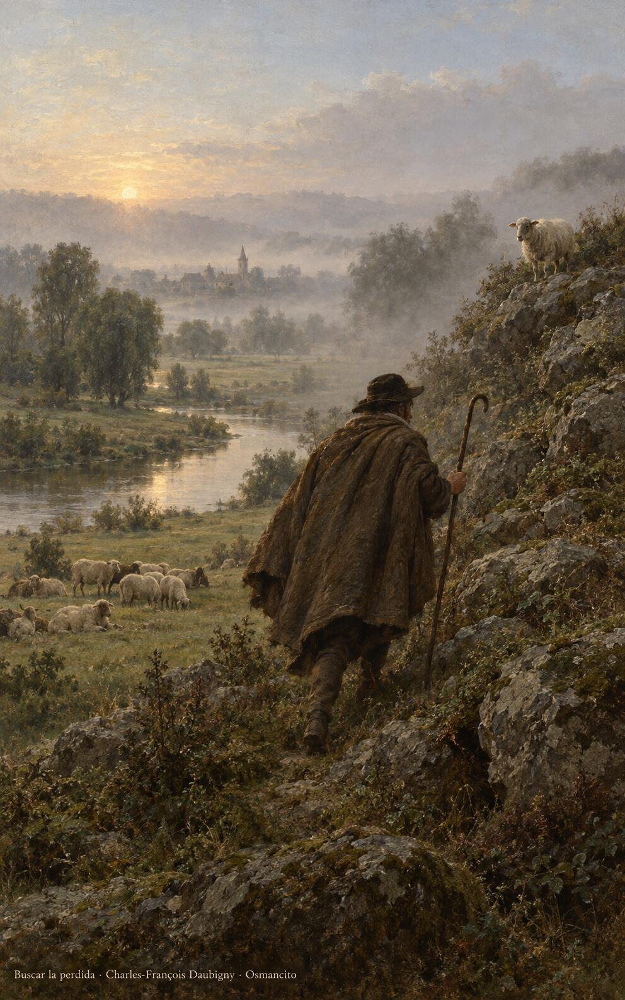
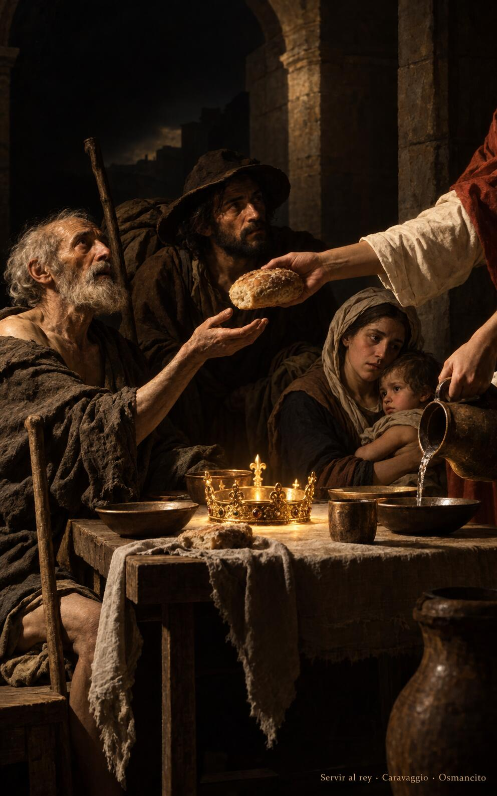

22 de noviembre de 2026

_¡Buenos días!_

# El rey pastor

**43**

> Cuando lo hicieron con el más insignificante de mis hermanos, conmigo lo hicieron.

Mateo 25,40. [Fuente](https://bible.usccb.org/es/bible/lecturas/112226.cfm)

_Que el pastor nos busque cuando nos dispersemos en la niebla y nos haga reposar en praderas verdes. Que nada nos falte: mesa preparada, copa llena, herida curada, descarriado devuelto. Que reconozcamos al rey en el hambriento, en el sediento, en el forastero, en el preso, y que lo que hagamos con el más pequeño se lo hagamos a él. Que reine hasta entregar el reino al Padre, y que seamos ovejas a su derecha._

- El pastor cruza la ladera brumosa hacia la oveja extraviada mientras el rebaño reposa junto al río tranquilo: Ezequiel 34, yo mismo iré a buscar a mis ovejas.

- Sobre la mesa servida para los humildes brilla una corona entre los platos: Mateo 25, lo hecho al más insignificante se lo hacemos al rey.

**_¡Feliz domingo 22 de noviembre!_**

😊🙋‍♂

© 2026 Osmancito
