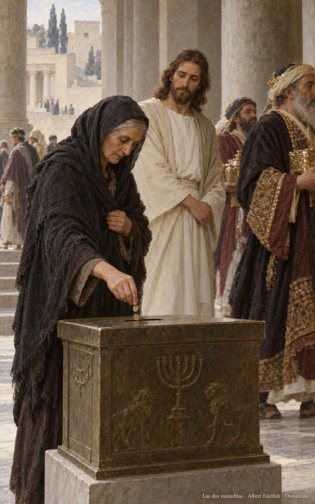
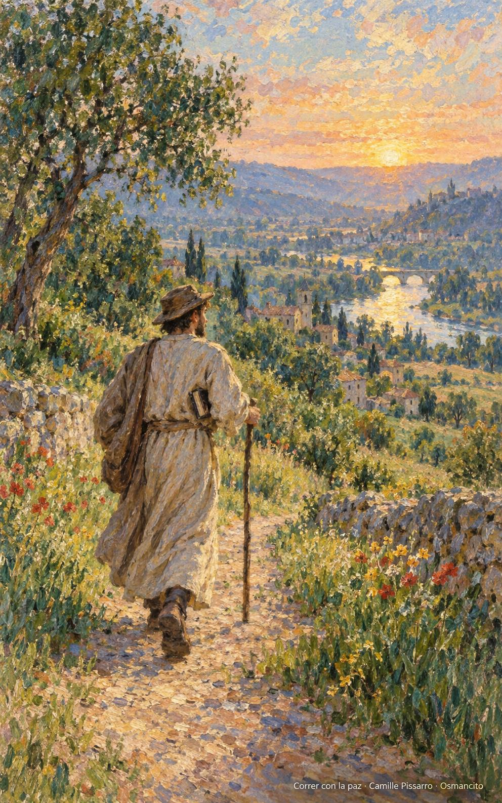
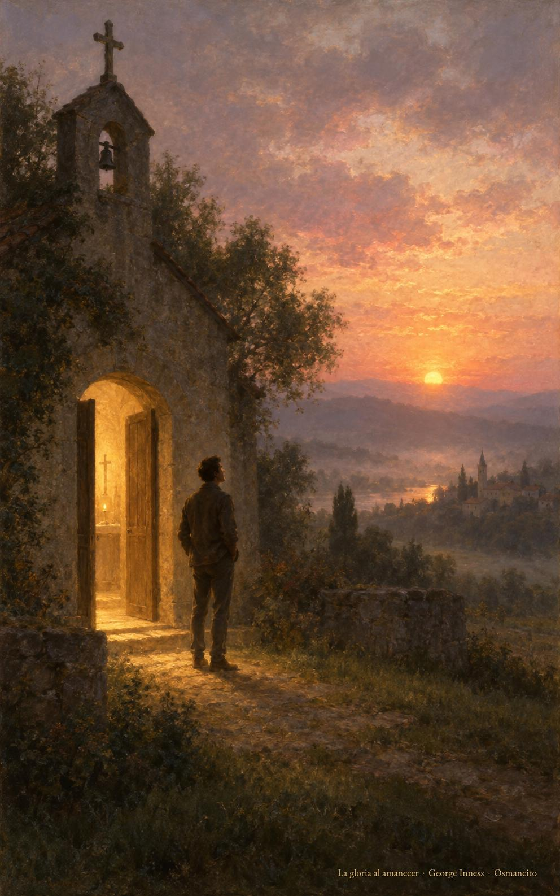
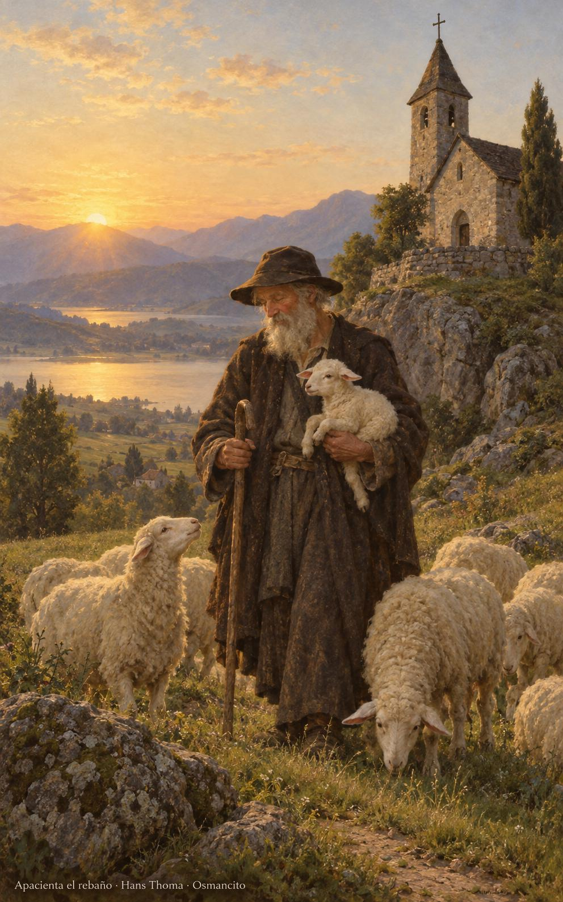

23 de noviembre de 2026

_¡Buenos días!_

# Todo lo que tenía

**44**

> Ella, en su pobreza, ha dado todo lo que tenía para vivir.

Lucas 21,4. [Fuente](https://bible.usccb.org/es/bible/lecturas/112326.cfm)

_Que cantemos al Cordero un cántico nuevo y le sigamos a dondequiera que vaya, con el corazón limpio y las manos abiertas. Que busquemos tu rostro, Dios de Jacob, y que nuestra ofrenda, aunque pequeña, sea entera como la de la viuda: dos moneditas que valen más que todo lo demás, porque dio todo lo que tenía para vivir. Que nunca demos solo lo que nos sobra, sino lo que somos, con alegría y confianza._

- La viuda deja caer sus dos moneditas en la alcancía del templo mientras Jesús la mira: Lucas 21, dio todo lo que tenía para vivir.

- Las dos monedas de la mano abierta brillan como soles y su luz sube hasta el monte donde canta la multitud: Apocalipsis 14 y Lucas 21, darlo todo es el cántico nuevo.

**_¡Feliz lunes 23 de noviembre!_**

😊🙋‍♂

## San Columbano, abad

[Lecturas de la memoria](https://bible.usccb.org/es/bible/lecturas/1123b-memoria.cfm)

_Que corramos sobre los montes como mensajeros que anuncian la paz, que pregonan la salvación: tu Dios es rey. Que cantemos al Señor un cántico nuevo y proclamemos su amor de nación en nación. Que sigamos a Jesús a dondequiera que vaya, sin pedir dónde reclinar la cabeza, y que anunciemos el Reino de Dios con el arado en las manos y los ojos adelante, misioneros como Columbano hasta el fin de la tierra entera._

- El mensajero cruza los montes con su báculo para anunciar la paz: Isaías 52, qué hermoso es ver correr al que trae la buena nueva.

**_¡Feliz memoria de san Columbano!_**

## Beato Miguel Agustín Pro, presbítero y mártir

[Lecturas de la memoria](https://bible.usccb.org/es/bible/lecturas/1123c-memoria.cfm)

_Que seamos testigos de los sufrimientos de Cristo y participantes de la gloria que se va a manifestar. Que ninguna amenaza nos apague la alegría ni apague el altar: que cuidemos el rebaño que Dios nos confió de buena gana, con entrega generosa y dando buen ejemplo, como Miguel, presbítero y mártir, que entregó la vida anunciando al Rey de los reyes. Que recibamos, cuando aparezca el Pastor supremo, el premio inmortal de la gloria._

- El sacerdote joven espera sereno la gloria en la puerta de su iglesia al amanecer: 1 Pedro 5, testigo de los sufrimientos de Cristo y participante de la gloria.

**_¡Feliz memoria del beato Miguel Agustín Pro!_**

## San Clemente I, Papa y mártir

[Lecturas de la memoria](https://bible.usccb.org/es/bible/lecturas/1123a-memoria.cfm)

_Que apacientemos el rebaño que Dios nos confió, no obligados ni por ambición, sino con entrega generosa, dando siempre buen ejemplo. Que confesemos como Pedro: tú eres el Mesías, el Hijo de Dios vivo, y que sobre la piedra de la fe se edifique la Iglesia. Que proclamemos sin cesar tu misericordia y tu lealtad por todas las edades, y que cuando aparezca el Pastor supremo recibamos con Clemente la corona inmortal de la gloria._

- El anciano pastor cuida su rebaño al alba junto a una pequeña iglesia de piedra: 1 Pedro 5 y Mateo 16, apacienta el rebaño que Dios te confió.

**_¡Feliz memoria de san Clemente I!_**

© 2026 Osmancito
