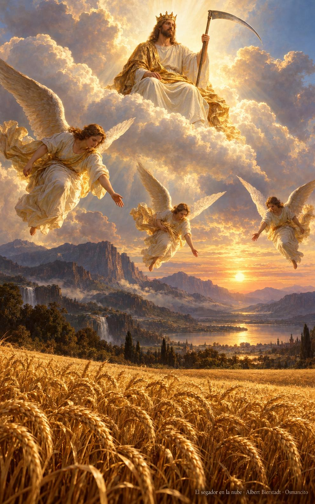
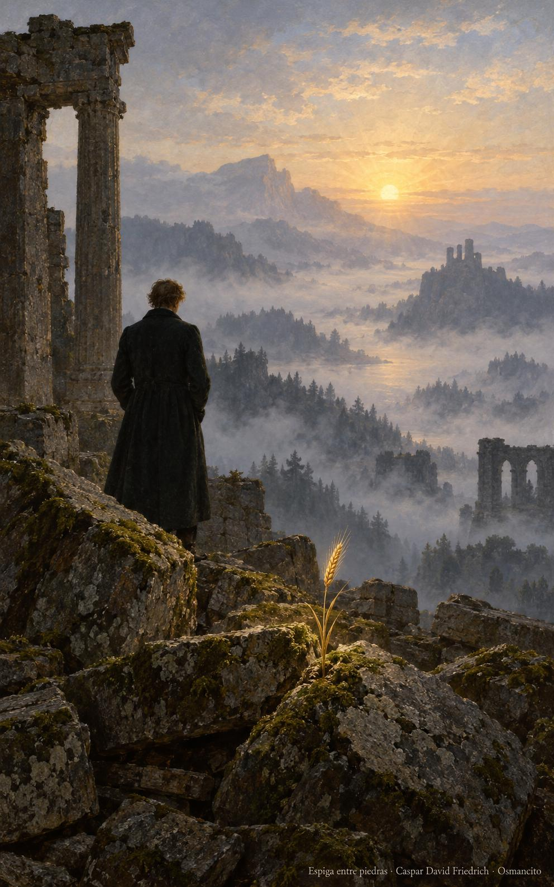
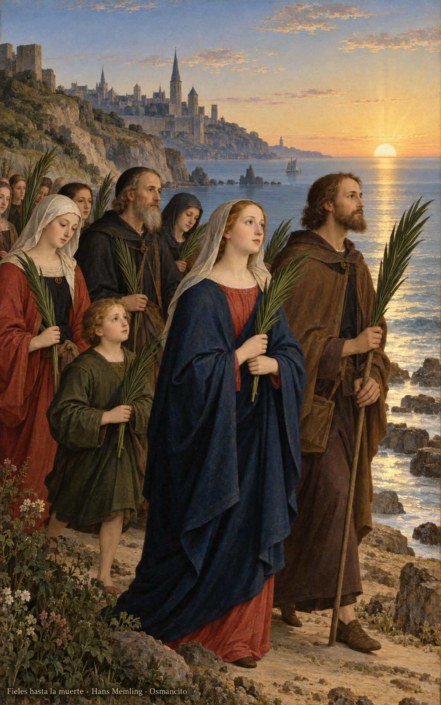

24 de noviembre de 2026

_¡Buenos días!_

# La mies madura

**45**

> Sé fiel hasta la muerte y te daré como premio la vida.

Apocalipsis 2,10. [Fuente](https://bible.usccb.org/es/bible/lecturas/112426.cfm)

_Que la mies de nuestra vida madure al sol de cada día, lista para la hoz del segador, y que ninguna piedra del templo nos ate el corazón: todo lo construido pasa, tu palabra queda. Que no nos domine el pánico cuando tiemble la tierra ni nos engañen los que usurpan tu nombre. Que todo se alegre ante el Señor que viene a gobernar con justicia y rectitud, y que seamos fieles hasta el fin._

- La figura coronada, sentada sobre la nube blanca, pasa la hoz sobre el campo de trigo maduro mientras los ángeles se acercan: Apocalipsis 14, la mies de la tierra está madura.

- Una espiga de trigo dorado crece erguida entre las piedras caídas del templo, hacia la luz del amanecer: Lucas 21, no quedará piedra sobre piedra, y la palabra permanece.

**_¡Feliz martes 24 de noviembre!_**

😊🙋‍♂

## San Andrés Dũng-Lạc, presbítero, y compañeros, mártires

[Lecturas de la memoria](https://bible.usccb.org/es/bible/lecturas/112426.cfm)

_Que seamos fieles hasta la muerte, como Andrés y sus compañeros, que sembraron el Evangelio en su tierra y lo regaron con su sangre. Que ninguna amenaza nos quite la alegría de anunciar tu nombre, y que la corona de la vida nos encuentre firmes. Que la mies de testigos madure en nosotros: que demos fruto de valentía, perdón y esperanza, y que todo se alegre ante el Señor que viene a gobernar la tierra._

- El grupo de fieles camina por la orilla con palmas en las manos, hacia la luz dorada que se abre en el horizonte: Apocalipsis 2, sé fiel hasta la muerte y te daré la vida.

**_¡Feliz memoria de san Andrés Dũng-Lạc y compañeros!_**

© 2026 Osmancito
