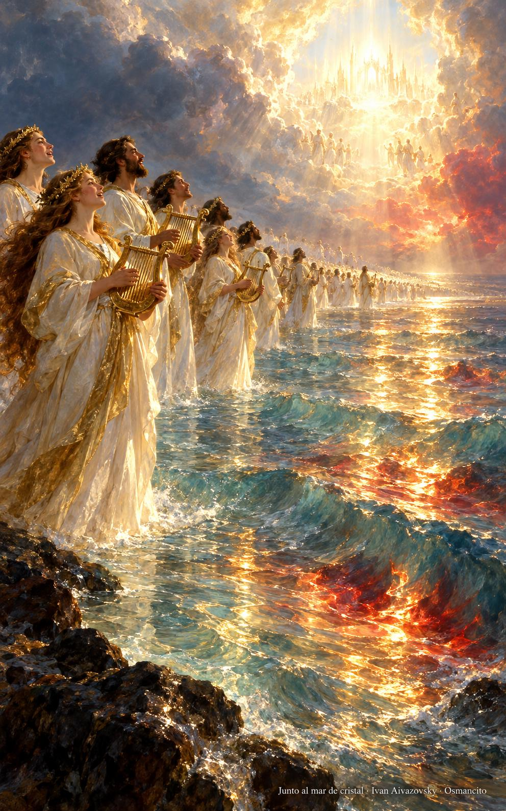
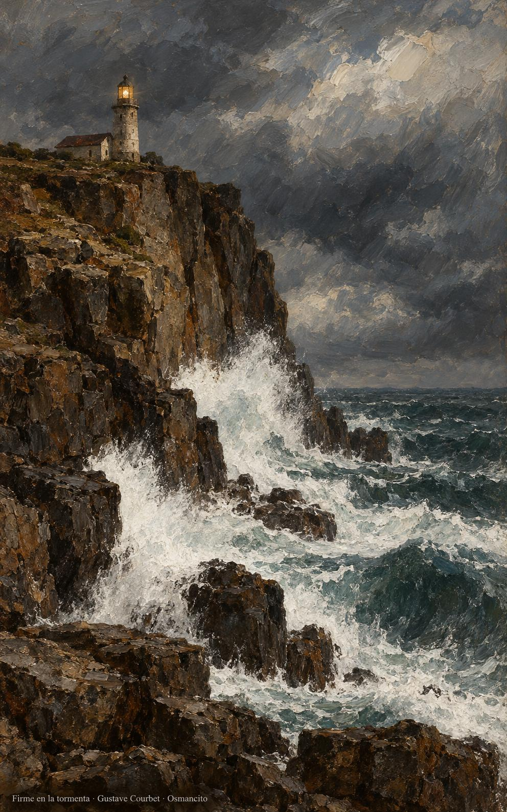
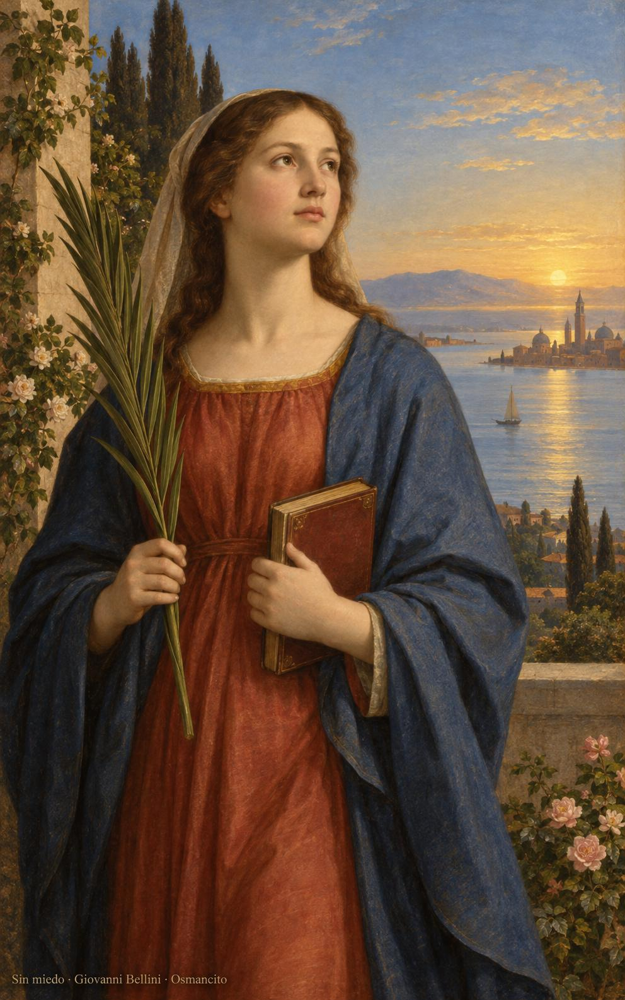

25 de noviembre de 2026

_¡Buenos días!_

# Ni un cabello

**46**

> Si se mantienen firmes, conseguirán la vida.

Lucas 21,19. [Fuente](https://bible.usccb.org/es/bible/lecturas/112526.cfm)

_Que cantemos junto al mar de cristal el cántico de los vencedores, con las cítaras que tú nos das, porque grandes y maravillosas son tus obras. Que los ríos aplaudan de gozo. Que no preparemos defensa cuando nos lleven ante reyes y gobernantes: tú pondrás en nuestra boca palabras sabias que ningún adversario resista. Que nos mantengamos firmes, sin miedo, porque ni un cabello de nuestra cabeza perecerá, y que firmes consigamos la vida prometida._

- Los vencedores, de pie junto al mar de cristal mezclado con fuego, cantan con las cítaras que Dios les dio: Apocalipsis 15, grandes y maravillosas son tus obras.

- Una pequeña luz brilla firme en lo alto del peñasco mientras las olas rompen abajo: Lucas 21, ni un cabello perecerá; el que se mantiene firme conseguirá la vida.

**_¡Feliz miércoles 25 de noviembre!_**

😊🙋‍♂

## Santa Catalina de Alejandría, virgen y mártir

[Lecturas de la memoria](https://bible.usccb.org/es/bible/lecturas/1125-memoria.cfm)

_Que no temamos a los que matan el cuerpo y no pueden matar el alma: hasta los cabellos de nuestra cabeza están contados y valemos más que los pájaros. Que te reconozcamos delante de los hombres, como Catalina, virgen y mártir, y que tú nos reconozcas ante el Padre. Que bebamos gratis del manantial del agua de la vida, salvados como un ave de la trampa del cazador, y que el vencedor reciba su herencia._

- La joven sostiene la palma y el libro en el jardín al amanecer, sin miedo: Mateo 10, valen ustedes mucho más que todos los pájaros.

**_¡Feliz memoria de santa Catalina de Alejandría!_**

© 2026 Osmancito
