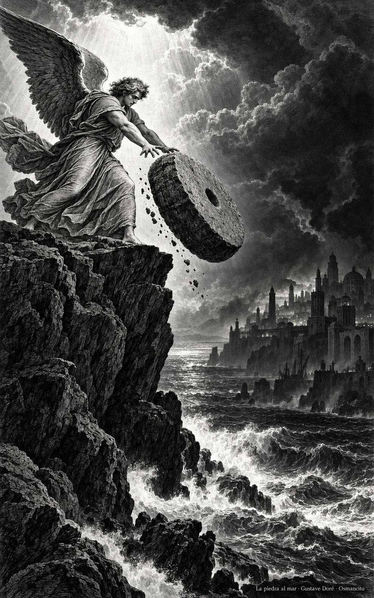
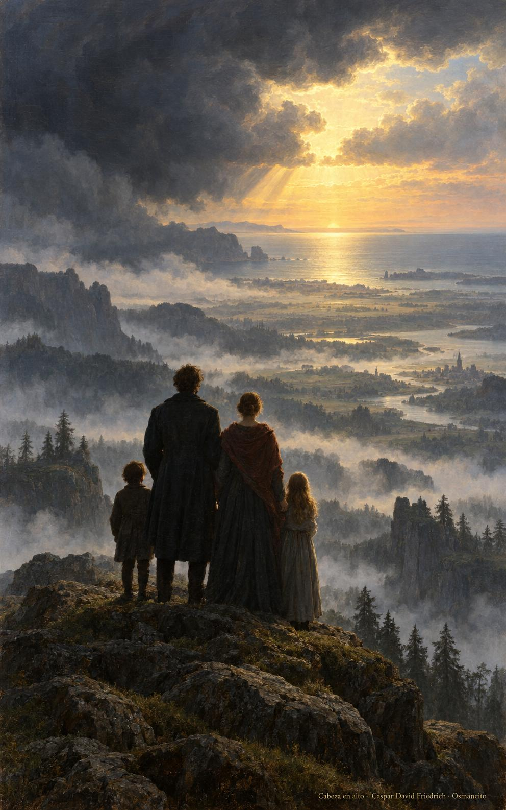

26 de noviembre de 2026

*¡Buenos días!*

# Levanten la cabeza

**47**

> Estén atentos y levanten la cabeza, porque se acerca la hora de su liberación.

Lucas 21,28. [Fuente](https://bible.usccb.org/es/bible/lecturas/112626-Ordinary)

*Que no nos seduzca la ciudad que se cree eterna, con sus comercios y sus luces, porque cae de pronto como piedra en el mar. Que sirvamos con alegría al que nos hizo y entremos por sus puertas dando gracias, pues su misericordia no se acaba. Cuando todo tiemble y las estrellas se bamboleen, que levantemos la cabeza sin miedo, entre cantos de aleluya, invitados dichosos al banquete del Cordero: nuestra liberación ya está cerca.*

- El ángel arroja al mar la piedra de molino mientras se apagan las luces de la gran ciudad: Apocalipsis 18, con esta misma violencia será arrojada Babilonia, y la multitud del cielo canta aleluya.

- La familia alza el rostro hacia la luz que rompe la tormenta sobre el valle: Lucas 21, levanten la cabeza, porque se acerca la hora de su liberación.

***¡Feliz jueves 26 de noviembre!***

😊🙋‍♂

© 2026 Osmancito

[Capilla](../capilla.html)
