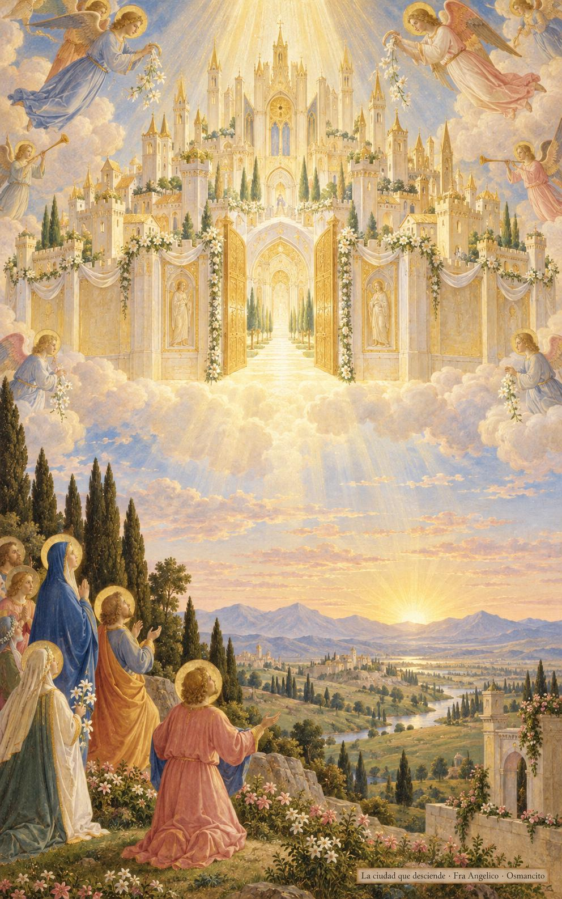
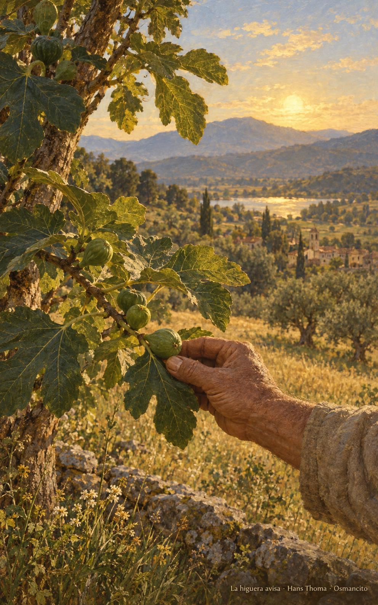

27 de noviembre de 2026

*¡Buenos días!*

# Palabras que no pasan

**48**

> Podrán dejar de existir el cielo y la tierra, pero mis palabras no dejarán de cumplirse.

Lucas 21,33. [Fuente](https://bible.usccb.org/es/bible/lecturas/112726.cfm)

*Que no temamos el juicio del trono, donde cada uno responde por sus obras, porque el dragón queda encadenado y la muerte será arrojada al fuego. Que anhelemos los atrios del Señor como el gorrión que encuentra casa cerca de sus altares. Que leamos la higuera que da fruto y sepamos que el Reino está cerca: aunque pasen el cielo y la tierra, sus palabras no pasarán, y veremos la ciudad nueva descender como novia.*

- La ciudad santa desciende del cielo engalanada como una novia sobre una tierra nueva: Apocalipsis 21, vi un cielo nuevo y una tierra nueva, y el mar ya no existía.

- La mano reconoce los primeros frutos de la higuera en la mañana que anuncia el verano: Lucas 21, cuando vean que suceden estas cosas, sepan que el Reino de Dios está cerca.

***¡Feliz viernes 27 de noviembre!***

😊🙋‍♂

© 2026 Osmancito

[Capilla](../capilla.html)
