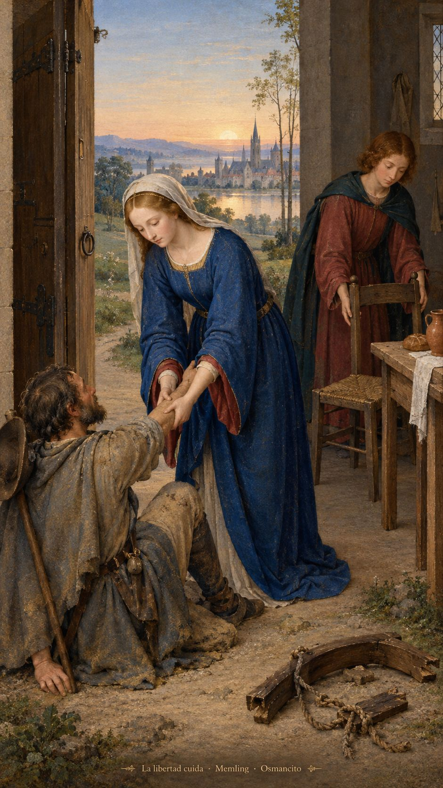
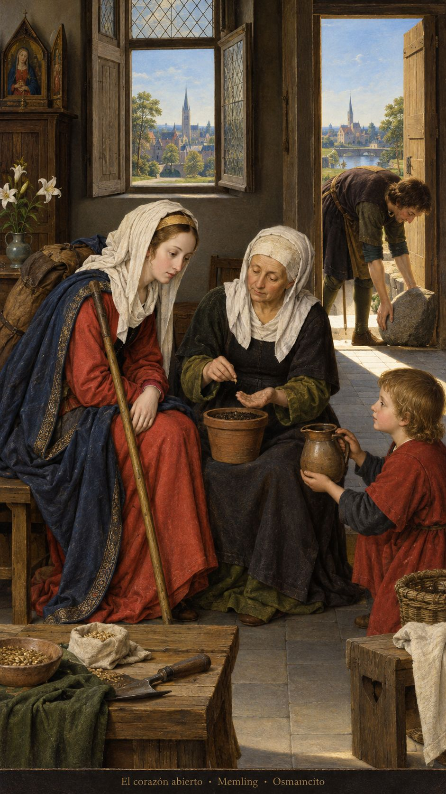

12 de octubre de 2026

_¡Buenos días!_

# La libertad cuida

**2**

> Cristo nos ha liberado para que seamos libres. Conserven, pues, la libertad y no se sometan de nuevo al yugo de la esclavitud.

Gálatas 5,1. [Fuente](https://bible.usccb.org/es/bible/lecturas/101226.cfm)

_Que cuidemos la libertad recibida y no volvamos a llamar hogar a lo que nos encierra. Que levantemos del polvo a quien quedó sin fuerzas y hagamos sitio a su voz. Que no esperemos señales enormes para empezar a cambiar: basta escuchar de verdad, reconocer el daño y dar un paso distinto. Que la sabiduría nos encuentre dispuestos, aunque llegue de lejos. Que desde el amanecer hasta la noche agradezcamos la vida que compartimos juntos._

- El yugo abandonado recoge la libertad de Gálatas 5. El viajero levantado del polvo y la silla que lo espera recuerdan el Salmo 112.

- La viajera que escucha evoca a la reina del sur de Lucas 11. La semilla y la piedra retirada vuelven gesto la disposición a cambiar y abrir el corazón.

**_¡Feliz lunes 12 de octubre!_**

😊🙋‍♂
