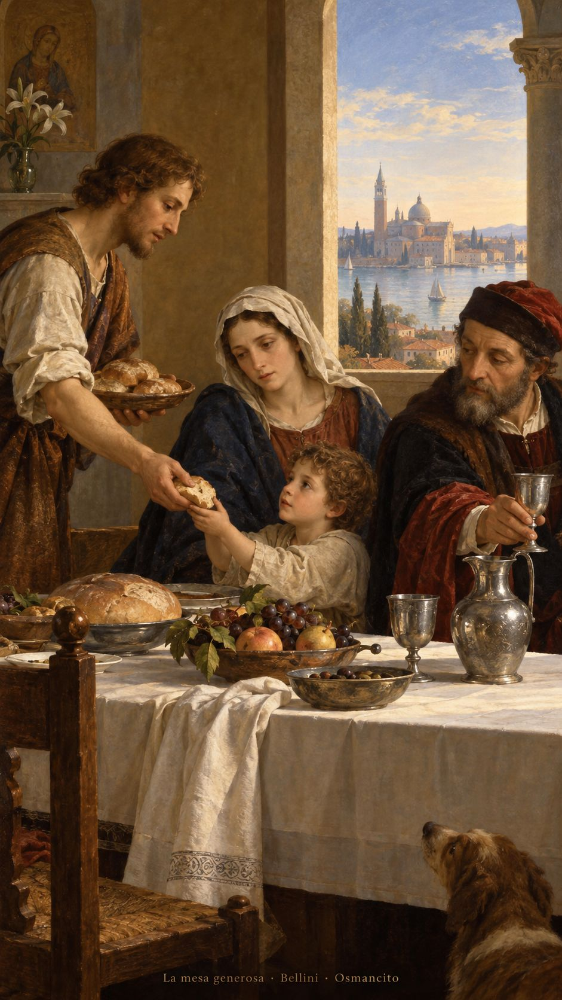
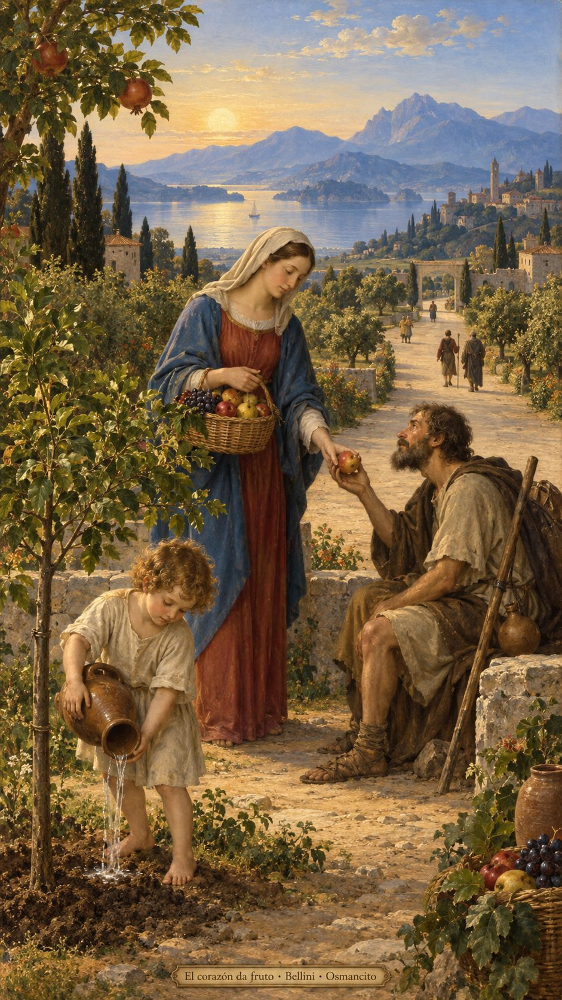

13 de octubre de 2026

_¡Buenos días!_

# La mesa generosa

**3**

> lo único que vale es la fe, que actúa a través de la caridad.

Gálatas 5,6. [Fuente](https://bible.usccb.org/es/bible/lecturas/101326.cfm)

_Que la libertad no se nos quede en palabras y encuentre manos dispuestas a compartir. Que limpiemos por dentro la copa de nuestros días, donde a veces guardamos miedo, orgullo y cuentas pendientes. Que el pan alcance a quien llega cansado y nuestra mesa no pregunte cuánto merece. Que caminemos por un camino ancho, sin encerrar el corazón en medidas. Que la confianza dé fruto en cariño y el cariño vuelva más habitable la mañana._

- La mesa y el pan compartido recogen la invitación de Lucas 11 a dar de lo que tenemos.

- El fruto ofrecido encarna la fe que actúa por la caridad, en Gálatas 5. El camino amplio recuerda el Salmo 118.

**_¡Feliz martes 13 de octubre!_**

😊🙋‍♂
