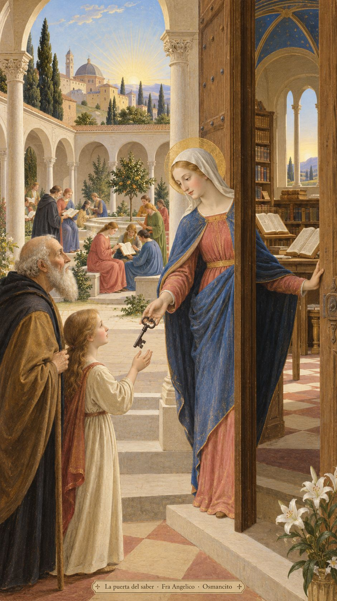
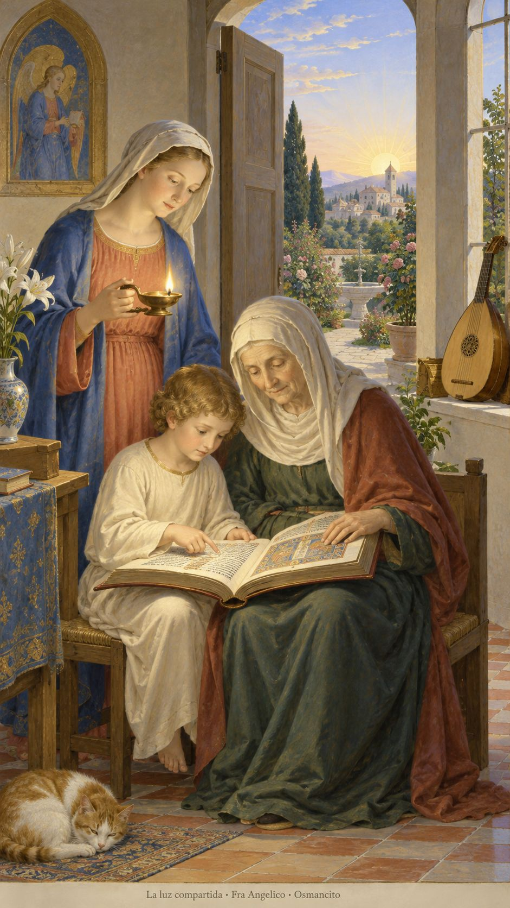
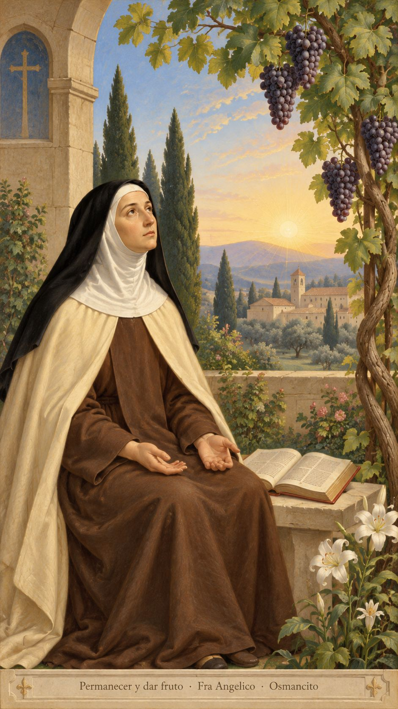

15 de octubre de 2026

_¡Buenos días!_

# La puerta del saber

**5**

> El nos eligió en Cristo, antes de crear el mundo, para que fuéramos santos e irreprochables a sus ojos, por el amor

Efesios 1,4. [Fuente](https://bible.usccb.org/es/bible/lecturas/101526.cfm)

_Que no guardemos la llave de aquello que puede alumbrar a otros. Que el saber abra puertas y nunca se vuelva una cerca. Que recibamos el día como un regalo anterior a nuestros méritos, con gratitud y manos abiertas. Que honremos a quienes dijeron la verdad escuchando también las voces incómodas de ahora. Que aprendamos a preguntar sin tender trampas, a enseñar sin humillar y a compartir la luz sin creernos dueños de su llama._

- La llave entregada y la puerta abierta responden a Lucas 11: el saber se comparte, no se guarda para impedir el paso.

- El libro leído entre generaciones encarna el saber que acompaña. El instrumento recuerda el canto nuevo del Salmo 97.

**_¡Feliz jueves 15 de octubre!_**

😊🙋‍♂

## Santa Teresa de Jesús, virgen y doctora de la Iglesia

[Lecturas de la memoria](https://bible.usccb.org/es/bible/lecturas/1015-memoria.cfm)

_Que sepamos esperar sin exigirle al silencio una respuesta inmediata. En la memoria de Teresa, que la oración tenga la sencillez de unas manos abiertas. Que permanezcamos unidos a lo que nos da vida, como la rama a la vid. Que aun cuando falten palabras, no nos falte confianza para acompañar a quien también espera._

- La vid recoge Juan 15; las manos abiertas y el silencio remiten a Romanos 8, cuando la oración no encuentra palabras.

**_¡Feliz memoria de santa Teresa de Jesús!_**
