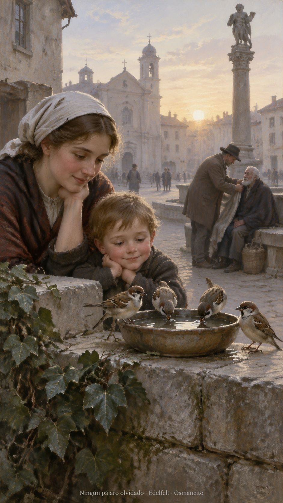
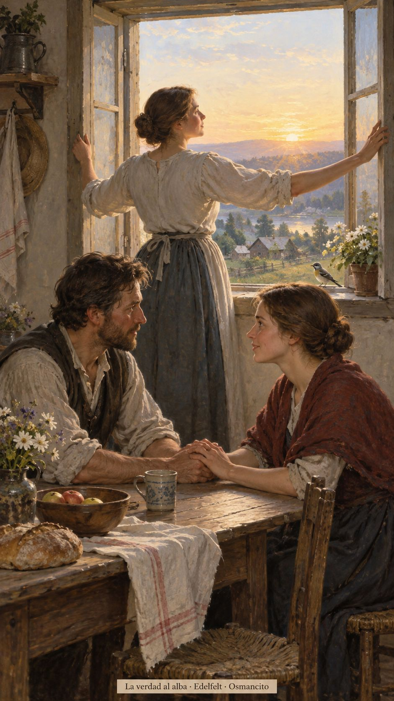
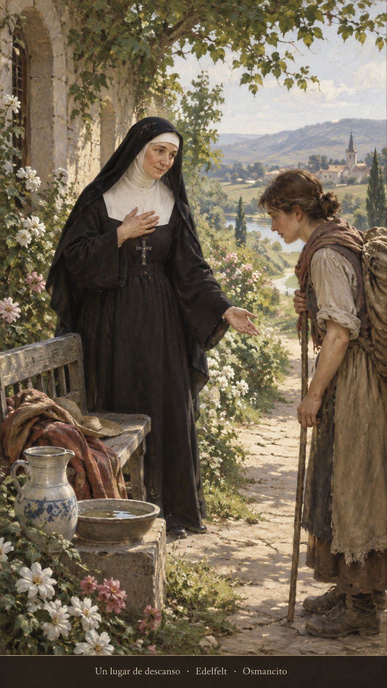
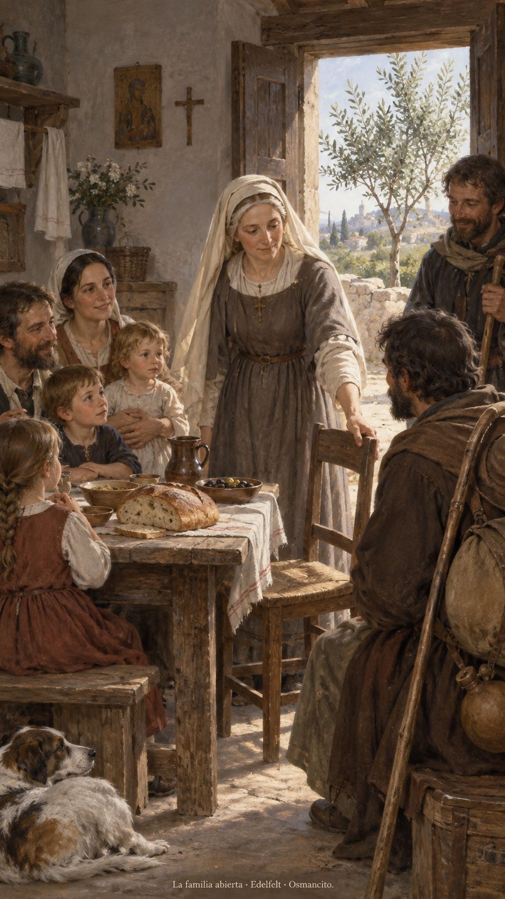

16 de octubre de 2026

_¡Buenos días!_

# Ningún pájaro olvidado

**6**

> No teman, pues, porque ustedes valen mucho más que todos los pajarillos

Lucas 12,7. [Fuente](https://bible.usccb.org/es/bible/lecturas/101626.cfm)

_Que no vivamos pendientes de una máscara ni escondamos la voz que pide aire. Que la verdad encuentre una ventana abierta y el miedo pierda sitio en nuestra mesa. Que cuidemos lo pequeño: un pájaro, una palabra, la mano que tiembla antes de llamar. Que recordemos nuestro valor cuando nadie aplauda y sepamos reconocerlo también en quien pasa inadvertido. Que la confianza no nos vuelva distraídos, sino atentos al mundo que nos ha sido confiado._

- Los pajarillos y el abrigo ofrecido recogen Lucas 12: el cuidado alcanza lo pequeño y sostiene la confianza.

- La ventana abierta encarna la verdad que sale a la luz en Lucas 12.

**_¡Feliz viernes 16 de octubre!_**

😊🙋‍♂

## Santa Margarita María Alacoque, virgen

[Lecturas de la memoria](https://bible.usccb.org/es/bible/lecturas/1016b-memoria.cfm)

_Que el amor eche raíces más hondas que el cansancio. En la memoria de Margarita María, que aprendamos la fuerza de un corazón humilde: no exige exhibiciones, ofrece descanso. Que sepamos acercar una silla, escuchar sin prisa y dejar que quien llega agobiado recupere el aliento. Que nadie confunda la ternura con debilidad._

- El asiento ofrecido recoge Mateo 11; el jardín y el agua evocan el descanso del Salmo 22.

**_¡Feliz memoria de santa Margarita María Alacoque!_**

## Santa Eduviges, religiosa

[Lecturas de la memoria](https://bible.usccb.org/es/bible/lecturas/1016a-memoria.cfm)

_Que la casa no termine en sus paredes. En la memoria de Eduviges, que la bondad cotidiana nos enseñe a hacer familia con quienes necesitan amparo. Que el trabajo de nuestras manos llegue a la mesa y que siempre podamos acercar una silla. Que la paz del hogar crezca cuando alguien nuevo encuentre lugar._

- La mesa y el olivo recuerdan el Salmo 127. La silla para el viajero encarna la familia abierta de Marcos 3.

**_¡Feliz memoria de santa Eduviges!_**

