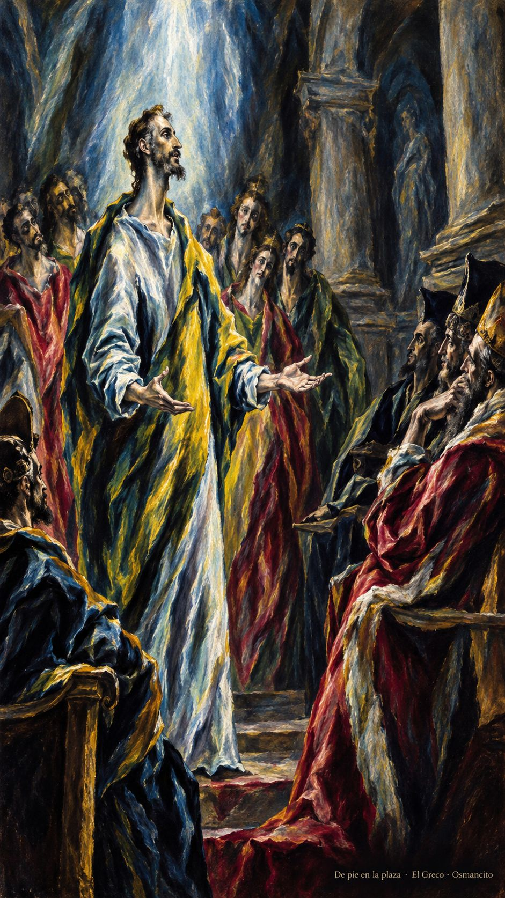
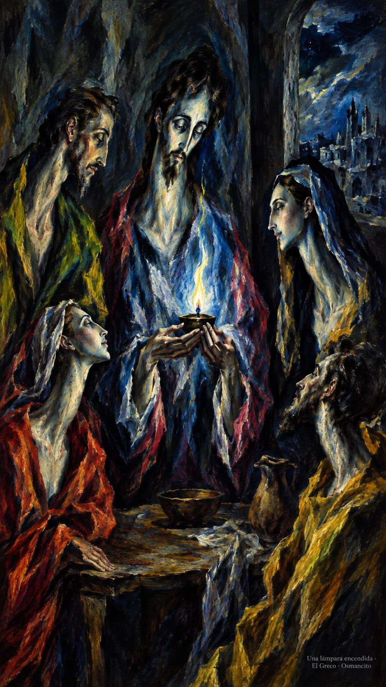
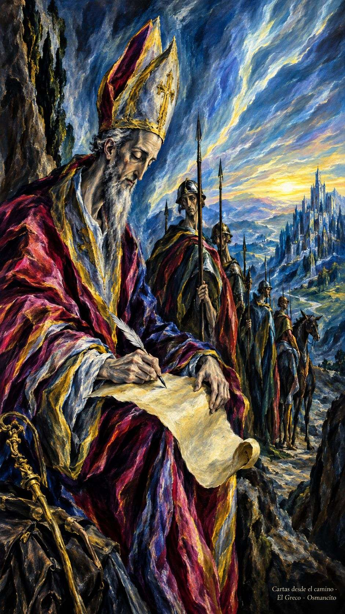

17 de octubre de 2026

_¡Buenos días!_

# El nombre bueno

**7**

> Yo les aseguro que a todo aquel que me reconozca abiertamente ante los hombres, lo reconocerá abiertamente el Hijo del hombre ante los ángeles de Dios

Lucas 12,8. [Fuente](https://bible.usccb.org/es/bible/lecturas/101726.cfm)

_Que la palabra no se quede en el bolsillo cuando el mundo pregunte por lo que creemos. Que aprendamos a decir el nombre bueno sin levantar la voz, como quien enciende una lámpara y no presume del fuego. Que el miedo no elija las respuestas ni nos vista de silencio ante los que miran. Que seamos testigos sencillos: fieles en lo pequeño, firmes en la tormenta. Que el Espíritu enseñe a su hora la palabra._

- El que habla sin miedo ante los jueces recoge Lucas 12: el Espíritu enseña la palabra a su hora.

- La lámpara pequeña encarna la palabra buena: no presume del fuego, basta sostenerla.

**_¡Feliz sábado 17 de octubre!_**

😊🙋‍♂

## San Ignacio de Antioquía, obispo y mártir

[Lecturas de la memoria](https://bible.usccb.org/es/bible/lecturas/1017-memoria.cfm)

_Que no nos pese el camino cuando conduce a la verdad. En la memoria de Ignacio, obispo que escribía cartas camino del martirio, aprendamos a llamar a las cosas por su nombre: al pan, pan; a la entrega, entrega. Que la fe no sea adorno sino trigo dispuesto, y que la comunidad sea cuerpo y no tumulto. Que podamos decir, con la vida entera, a quién pertenecemos._

- Ignacio escribe camino de Roma: las cartas de un obispo que se sabe trigo de Dios.

**_¡Feliz memoria de san Ignacio de Antioquía!_**

