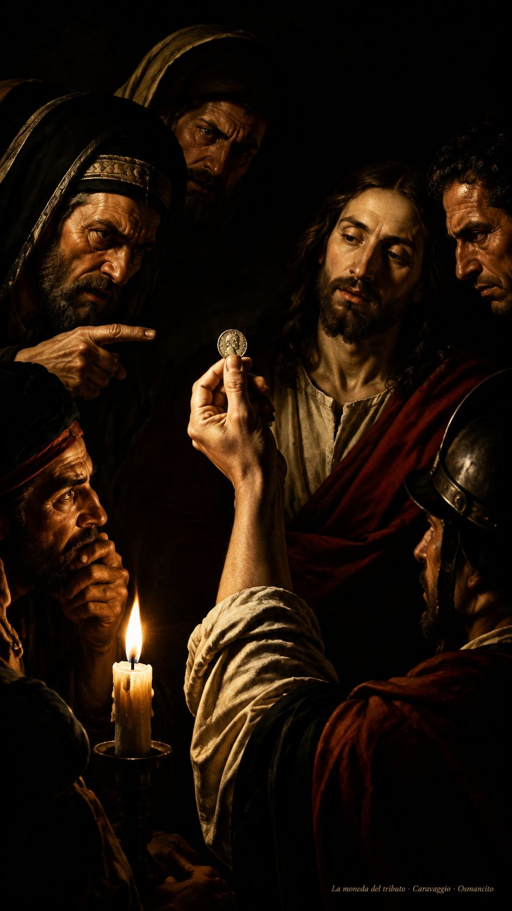
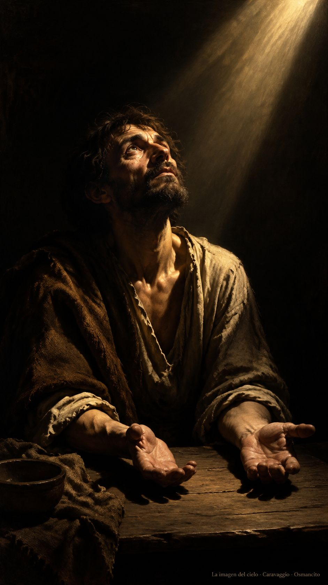

18 de octubre de 2026

_¡Buenos días!_

# La moneda y el rostro

**8**

> Den, pues, al César lo que es del César, y a Dios lo que es de Dios

Mateo 22,21. [Fuente](https://bible.usccb.org/es/bible/lecturas/101826.cfm)

_Que no entreguemos al poder lo que es de Dios. Que sepamos mirar la moneda y también el rostro: uno lleva inscripción de emperador, el otro lleva la imagen del cielo. Que paguemos con justicia lo que se debe y guardemos el alma lejos de toda venta. Que ninguna pregunta insidiosa nos arranque la verdad ni la prisa nos haga olvidar quiénes somos. Que el nombre con que fuimos llamados pese más que cualquier título._

- La moneda mostrada ante los interrogadores recoge Mateo 22: cada cosa recibe su nombre y su dueño.

- El rostro alzado y las manos vacías encarnan lo que no se vende: la imagen de Dios en la persona.

**_¡Feliz domingo 18 de octubre!_**

😊🙋‍♂

