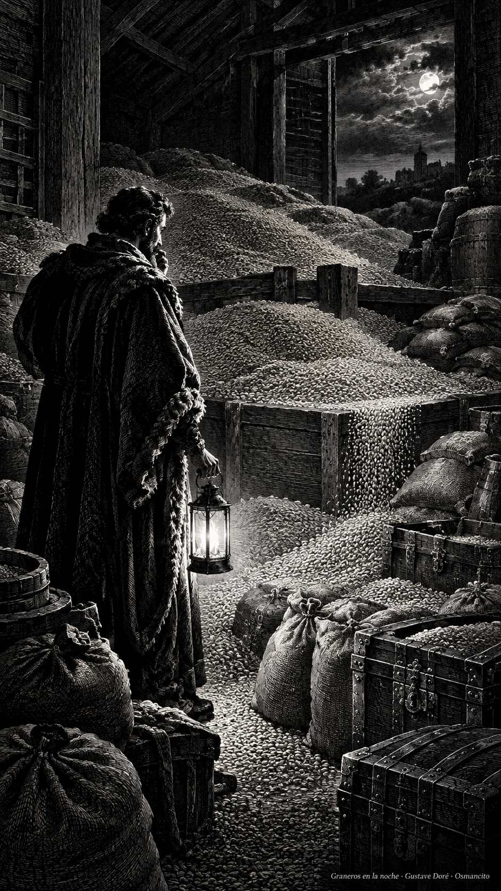
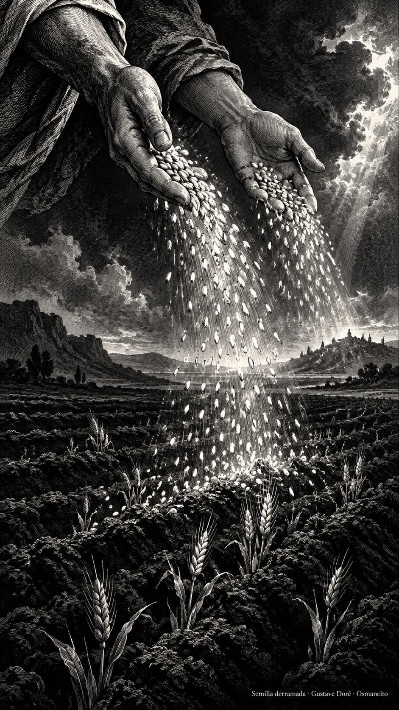
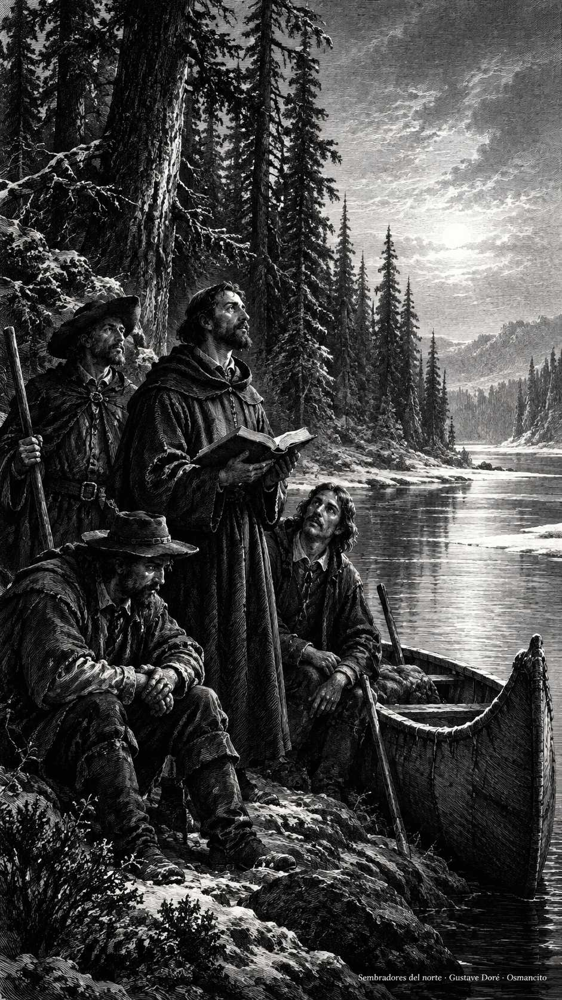

19 de octubre de 2026

_¡Buenos días!_

# Lo que vale ante Dios

**9**

> Eviten toda clase de avaricia, porque la vida del hombre no depende de la abundancia de los bienes que posea

Lucas 12,15. [Fuente](https://bible.usccb.org/es/bible/lecturas/101926.cfm)

_Que no midamos la vida por lo que cabe en un granero. Que la abundancia no nos cierre el puño ni la prisa por guardar nos vacíe los días. Que seamos ricos de lo que vale: palabra cumplida, mesa compartida, trabajo honrado y un corazón desocupado de miedo. Que al final de la jornada podamos soltar lo acumulado como quien suelta una carga pesada. Que nada poseamos tan fuerte que no podamos entregarlo con alegría._

- Los graneros desbordados recogen Lucas 12: la abundancia guardada no sostiene la vida.

- El grano entregado a la tierra encarna la riqueza que vale ante Dios: dada, no guardada.

**_¡Feliz lunes 19 de octubre!_**

😊🙋‍♂

## Santos Juan de Brébeuf e Isaac Jogues, presbíteros, y compañeros, mártires

[Lecturas de la memoria](https://bible.usccb.org/es/bible/lecturas/1019-memoria.cfm)

_Que la fe no le tenga miedo a la distancia. En la memoria de Juan de Brébeuf, Isaac Jogues y sus compañeros, que cruzaron mares y bosques para sembrar el Evangelio en tierra ajena, aprendamos que la palabra buena aguanta el invierno. Que seamos semilla y no moneda: dados, no guardados. Que su coraje nos enseñe a gastar la vida en lo que permanece._

- La canoa y el libro en el bosque recuerdan a los misioneros que sembraron en tierra ajena.

**_¡Feliz memoria de los santos mártires Juan de Brébeuf, Isaac Jogues y compañeros!_**

