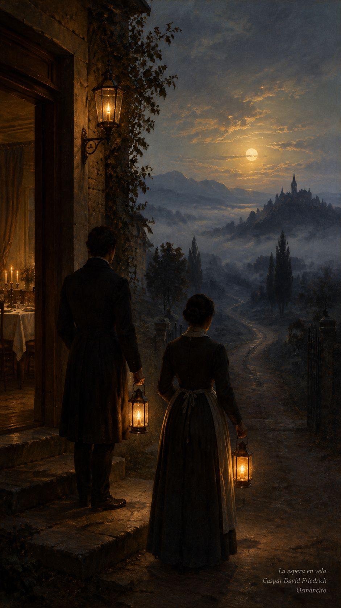
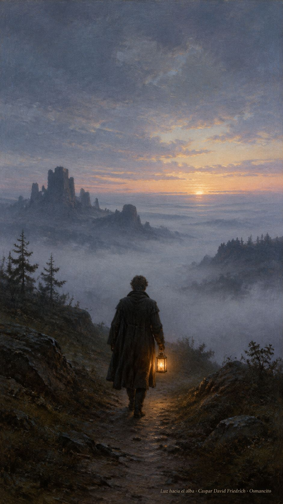
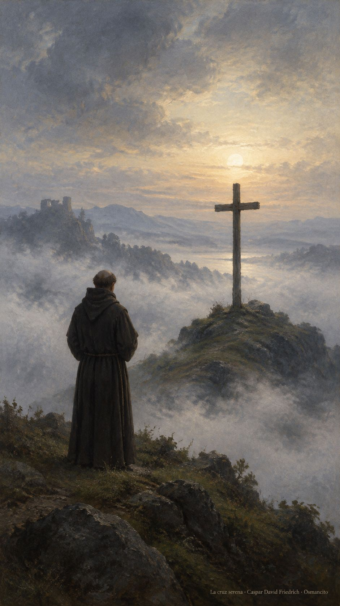

20 de octubre de 2026

_¡Buenos días!_

# La espera encendida

**10**

> Estén listos, con la túnica puesta y las lámparas encendidas

Lucas 12,35. [Fuente](https://bible.usccb.org/es/bible/lecturas/102026.cfm)

_Que la noche no nos encuentre apagados. Que tengamos la túnica ceñida y la lámpara al alcance de la mano, no por miedo al que llega sino por gusto de abrirle. Que la espera no sea duermevela triste sino casa ordenada, mesa puesta y corazón despierto. Que quien toque a la puerta a cualquier hora encuentre luz en la ventana y palabra amable. Que velar sea nuestra manera de querer: atentos, listos, sin ninguna prisa._

- Los criados con lámparas junto a la puerta recogen Lucas 12: la casa despierta espera al que vuelve.

- La luz pequeña caminando hacia la mañana encarna la vigilia que no se apaga.

**_¡Feliz martes 20 de octubre!_**

😊🙋‍♂

## San Pablo de la Cruz, presbítero

[Lecturas de la memoria](https://bible.usccb.org/es/bible/lecturas/1020-memoria.cfm)

_Que el dolor del mundo no nos sea ajeno. En la memoria de Pablo de la Cruz, que meditó la Pasión hasta hacerla escuela de ternura, aprendamos a mirar el sufrimiento de frente y a consolar sin fórmulas. Que la cruz no sea para nosotros adorno ni amenaza, sino recordatorio de que el amor aguanta. Que sepamos quedarnos junto a quien sufre, en silencio y sin prisa._

- El fraile ante la cruz en la niebla recuerda la escuela de ternura de Pablo de la Cruz.

**_¡Feliz memoria de san Pablo de la Cruz!_**

