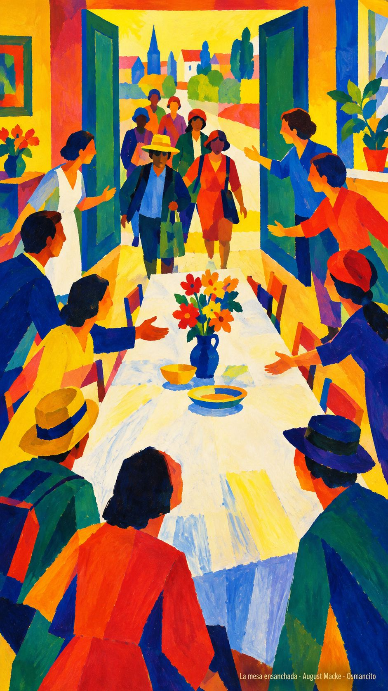
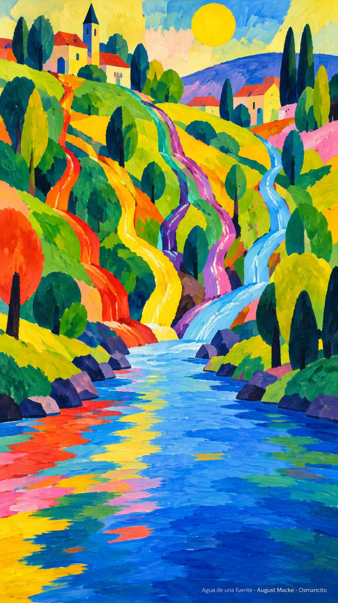

21 de octubre de 2026

_¡Buenos días!_

# La herencia de todos

**11**

> También los paganos son coherederos de la misma herencia, miembros del mismo cuerpo y partícipes de la misma promesa en Jesucristo

Efesios 3,6. [Fuente](https://bible.usccb.org/es/bible/lecturas/102126.cfm)

_Que nadie se quede fuera de la casa por llegar de lejos. Que aprendamos a decir hermano sin revisar primero el apellido ni el acento. Que la mesa se ensanche cuando alguien nuevo se acerque y la promesa no tenga aduana. Que seamos coherederos alegres de una herencia que no se gasta: cuerpo del mismo cuerpo, agua de la misma fuente. Que la sabiduría de Dios, que es multiforme, nos encuentre juntos y no repartidos._

- La mesa que se ensancha para el que llega recoge Efesios 3: la herencia no tiene aduana.

- Los arroyos reunidos en un solo cauce encarnan el mismo cuerpo y la misma promesa.

**_¡Feliz miércoles 21 de octubre!_**

😊🙋‍♂

