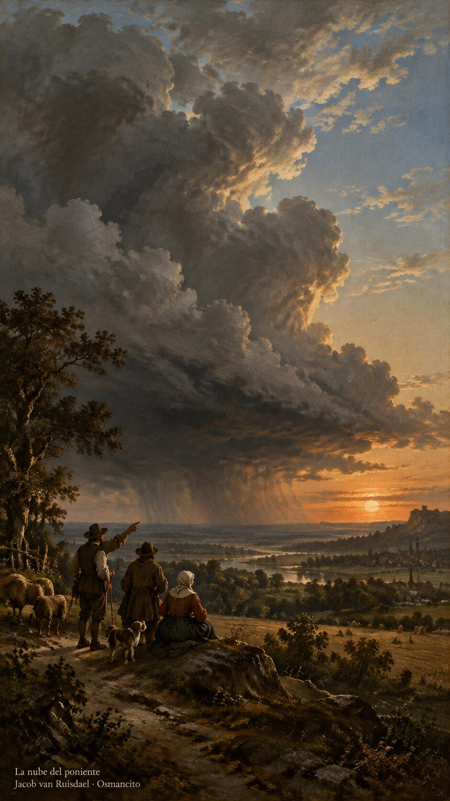
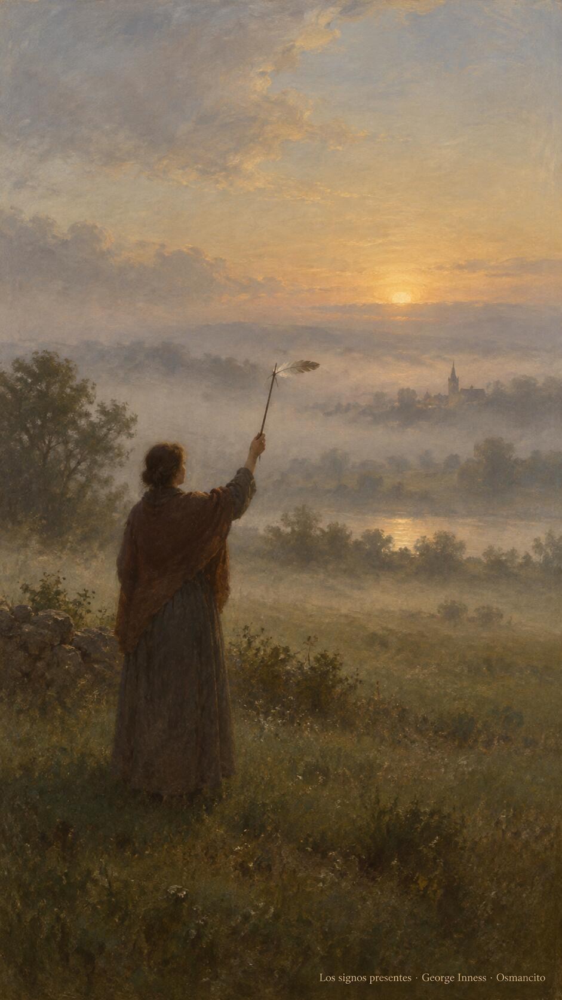
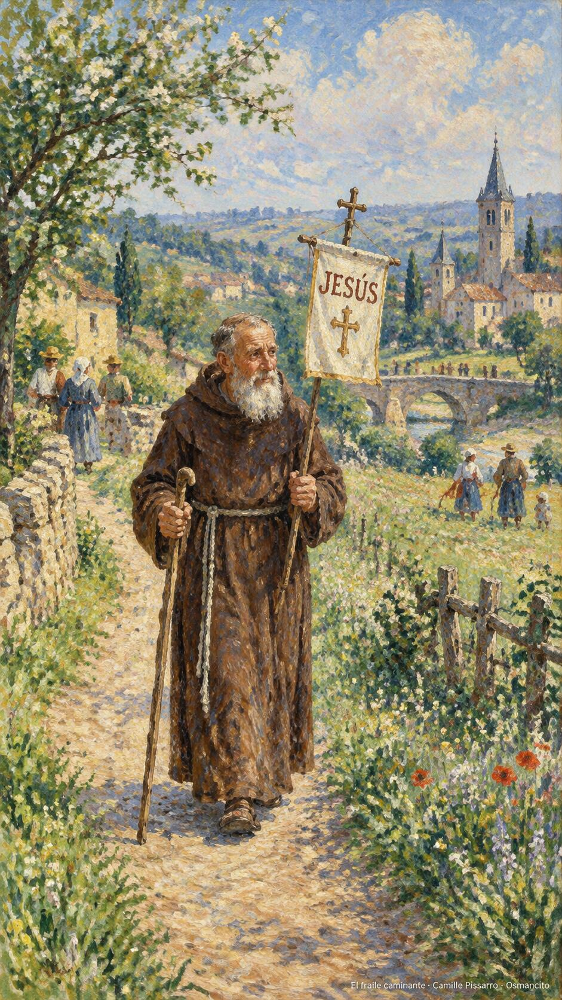

23 de octubre de 2026

_¡Buenos días!_

# Leer el tiempo

**13**

> Si saben interpretar el aspecto que tienen el cielo y la tierra, ¿por qué no interpretan entonces los signos del tiempo presente?

Lucas 12,56. [Fuente](https://bible.usccb.org/es/bible/lecturas/102326.cfm)

_Que aprendamos a leer el cielo de nuestra hora. Que no seamos expertos del pronóstico y analfabetos del corazón: sabemos cuándo llueve y no cuándo amar. Que los signos del tiempo presente no nos pasen de largo mientras miramos la nube equivocada. Que juzguemos por nosotros mismos lo que conviene hacer ahora, sin esperar que otro lo decida. Que el viento del sur nos avise, y lleguemos a tiempo al acuerdo y a la verdad._

- Los campesinos que leen la nube del poniente recogen Lucas 12: sabemos el tiempo de la lluvia y no el del corazón.

- La pluma alzada para sentir el viento encarna la atención al tiempo presente.

**_¡Feliz viernes 23 de octubre!_**

😊🙋‍♂

## San Juan de Capistrano, presbítero

[Lecturas de la memoria](https://bible.usccb.org/es/bible/lecturas/1023-memoria.cfm)

_Que la palabra no se nos quede en el escritorio. En la memoria de Juan de Capistrano, que recorrió Europa entera predicando a pie hasta los setenta años, aprendamos que el celo no conoce edad ni cansancio definitivo. Que prediquemos más con los zapatos que con la boca: yendo, acercándonos, gastándonos por la paz. Que el nombre de Jesús, que él llevaba por estandarte, sea también nuestra fuerza y nuestra dulzura._

- El fraile que camina con el estandarte de Jesús recuerda a Juan de Capistrano, predicador incansable.

**_¡Feliz memoria de san Juan de Capistrano!_**

© 2026 Osmancito
